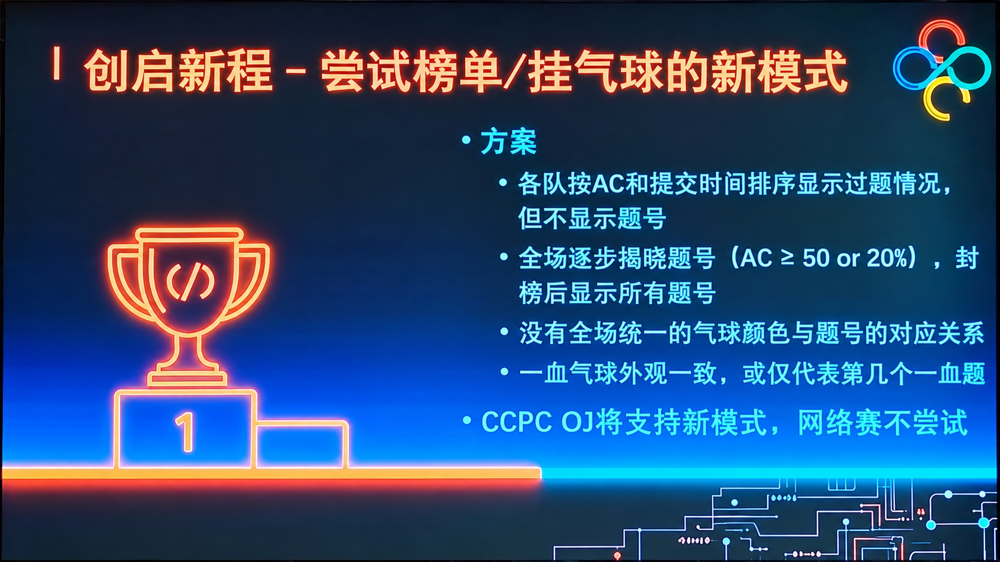

## Problem Statement

Time limit: 1 s; Memory limit: 512 MB.

To enhance the suspense and spectator appeal of the contest, the CCPC has introduced a new format featuring a "dynamic scoreboard/balloon-awarding" system. Under this format, the specific problem numbers solved by each team are not displayed immediately during the contest; instead, the scoreboard is revealed dynamically.

  
Introduction to the new CCPC rules

According to the rules, the scoreboard status for a specific problem "unfreezes" when any one of the following three conditions is met:

1.  The number of teams that have solved the problem is greater than or equal to $\mathbf{50}$.
2.  The number of teams that have solved the problem is greater than or equal to **$\mathbf{20\%}$ of the total number of participating teams (not necessarily an integer)**.
3.  The contest enters the "scoreboard freeze" period. Specifically, the time is represented by a string in the format "`HH:MM`" indicating the elapsed contest time; the freeze period begins at the $\mathbf{240}$-minute mark (inclusive).

Although the new format has not yet been officially finalized and is not used in the online contest, please implement this new rule for this problem to better prepare for the upcoming on-site contests.

Given a contest with $n$ participating teams, a problem solved by $m$ teams, and the current time, please determine whether the problem currently meets the criteria for unfreezing.

## Input

The first line contains an integer $T$ ($1 \le T \le 100$), representing the number of test cases.

The next $T$ lines each contain two integers $n,m$ ($2\leq n\leq 10^4$, $0\leq m\leq n$) and a string in "`HH:MM`" format, representing the total number of teams, the current number of teams that have solved a specific problem, and the current time, respectively. The input guarantees that the current time is between "`00:00`" and "`05:00`" (inclusive).

## Output

For each test case, output "`YES`" if the unfreezing condition is met, or "`NO`" otherwise.

## Examples

### Input 1

```text
5
100 50 00:00
100 10 03:59
100 10 04:00
100 20 02:00
10000 0 05:00
```

### Output 1

```text
YES
NO
YES
YES
YES
```

---

Source: [Original statement on QOJ](https://qoj.ac/problem/20728). Original wording retained; formatting converted to Markdown.
