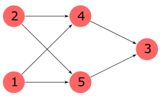
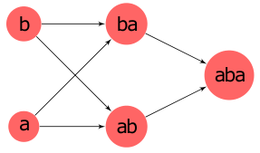
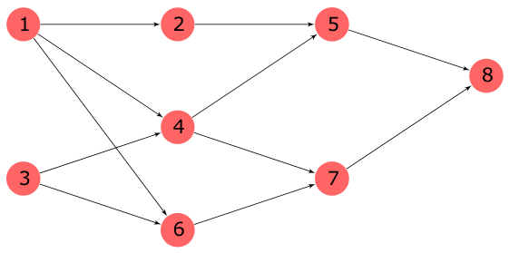
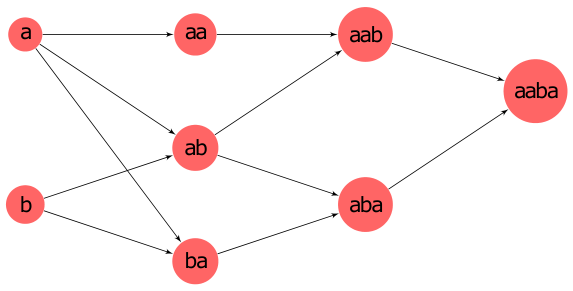

> QOJ 将此版本标注为 AI 翻译，可能存在不准确之处；有疑问时请核对原文。

## 题目描述

时间限制：8 秒；内存限制：1024 MB。

有一个由小写英文字母组成的字符串 $s$。Little Cyan Fish 很喜欢这个字符串，于是他记下了该字符串所有的唯一子串，并在它们之间添加了有向边。具体来说，对于两个不同的子串 $s_1$ 和 $s_2$，如果存在一个字母 $c$ 使得 $s_2 = s_1 + c$ 或 $s_2 = c + s_1$，他就会从 $s_1$ 到 $s_2$ 连一条有向边。之后，他删除了所有重复的边。最终，这构成了一个有向无环图（DAG）。

不幸的是，Little Cyan Fish 忘记了原始字符串 $s$。更糟糕的是，他也不记得 DAG 中每个节点对应的是哪个子串。现在他只拥有这个 DAG，你的任务是帮助 Little Cyan Fish 恢复原始字符串 $s$。由于可能存在多种可能的解，Little Cyan Fish 只对字典序最小的那一个感兴趣。

## 输入格式

输入包含多组测试数据。第一行包含一个整数 $T$ ($1 \le T \le 10^5$)，表示测试数据的组数。

对于每组测试数据，第一行包含两个整数 $n, m$ ($1 \le n \le 10^6, 0 \le m \le 2 \times 10^6$)，分别表示节点数和边数。

接下来的 $m$ 行中，第 $i$ 行包含两个整数 $u_i, v_i$ ($1 \le u_i, v_i \le n$)，表示一条从 $u_i$ 到 $v_i$ 的有向边。保证至少存在一个有效的解。

保证所有测试数据的 $n$ 之和不超过 $10^6$，所有测试数据的 $m$ 之和不超过 $2 \times 10^6$。

## 输出格式

对于每组测试数据，输出一行，包含一个由小写英文字母组成的字符串，表示答案。

## 样例

### 样例输入 1

```text
3
1 0
5 6
2 4
2 5
5 3
4 3
1 5
1 4
8 11
1 2
1 4
1 6
2 5
3 4
3 6
4 5
4 7
5 8
6 7
7 8
```

### 样例输出 1

```text
a
aba
aaba
```

## 说明

第一组样例对应的 DAG 如下：


每个节点对应的字符串如下：


第二组样例对应的 DAG 如下：



每个节点对应的字符串如下：



第三组样例对应的 DAG 如下：



每个节点对应的字符串如下：



---

来源：[QOJ 中文题面](https://qoj.ac/problem/6507/statement/zh_cn)。保留 QOJ 提供的中文内容，仅转换为 Markdown 排版；原题及图示版权归原作者所有。 QOJ 中文页中的失效图片已按原有顺序补为[官方英文题面](https://qoj.ac/download.php?type=attachments&id=1244&r=0)中的对应图示。
