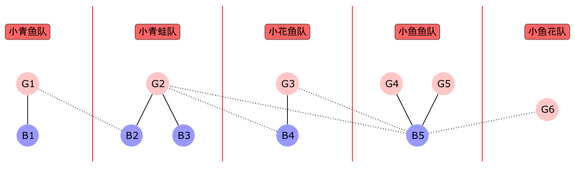

> QOJ 将此版本标注为 AI 翻译，可能存在不准确之处；有疑问时请核对原文。

## 题目描述

时间限制：5 秒；内存限制：1024 MB。

XCPC 训练队中有 $n_1$ 名男生和 $n_2$ 名女生，共有 $m$ 对男女之间存在关系。一个人可以与多个人建立关系，但同性别的人之间不会有关系。

Little Cyan Fish 是 XCPC 训练队的教练，他想将队员们分成若干个 XCPC 队伍。每个队伍的人数不能超过 3 人。为了使队伍“不异常”，如果一个队伍中有多于一名成员，则至少有一名成员必须与该队伍中的所有其他成员都有关系。

然而，独自参加 XCPC 并不愉快，因此 Little Cyan Fish 的目标是最小化单人队伍的数量。此外，当一个人与另外两名队友都有关系时，队伍可能会变得不稳定。因此，在最小化单人队伍数量的前提下，Little Cyan Fish 还希望最小化三人队伍的数量。

Little Cyan Fish 非常焦急地想要找到一种分组方式。为了让一切恢复正常，你需要帮助他完成分组任务，以便他的队伍能够去争夺冠军。XCPC 是他最喜欢的事业，请帮帮他！

## 输入格式

第一行包含三个整数 $n_1, n_2, m$ ($1 \le n_1, n_2 \le 10^5, 1 \le m \le 2 \times 10^5$)，分别表示男生人数、女生人数和关系对数。

接下来的 $m$ 行中，第 $i$ 行包含两个整数 $u_i, v_i$ ($1 \le u_i \le n_1, 1 \le v_i \le n_2$)，表示第 $u_i$ 号男生和第 $v_i$ 号女生之间存在关系。

保证所有的 $(u_i, v_i)$ 都是两两不同的。

## 输出格式

输出一行，包含两个整数，分别表示单人队伍的数量和三人队伍的数量。

## 样例

### 样例输入 1

```text
5 6 10
1 1
2 1
2 2
3 2
4 2
4 3
5 3
5 4
5 5
5 6
```

### 样例输出 1

```text
1 2
```

## 说明



---

来源：[QOJ 中文题面](https://qoj.ac/problem/6508/statement/zh_cn)。保留 QOJ 提供的中文内容，仅转换为 Markdown 排版；原题及图示版权归原作者所有。 QOJ 中文页中的失效图片已按原有顺序补为[官方英文题面](https://qoj.ac/download.php?type=attachments&id=1244&r=0)中的对应图示。
