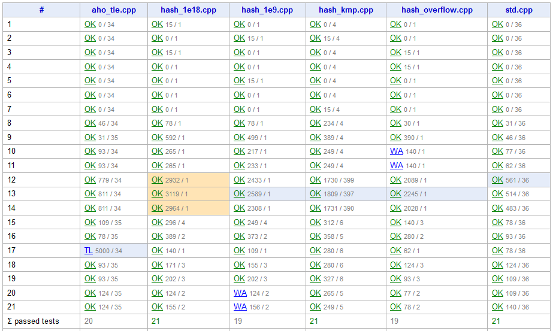

> QOJ 将此版本标注为 AI 翻译，可能存在不准确之处；有疑问时请核对原文。

## 题目描述

时间限制：3.0 秒；内存限制：512 MB。

准备一场可靠的编程竞赛是一项棘手的工作。有时，你可以通过设置庞大的测试集（例如，在第 400 个测试点上给出错误答案）来代替猜测参赛者如何解决问题。然而，庞大的测试集可能会给实现不佳的竞赛平台带来沉重的负担。如果判题过程没有很好地并行化，提交的流转时间将无法接受，你也会因此收到无数的投诉。

你所出的题目包含 $n$ 个测试点，以及 $m$ 个由不同测试人员编写的、你认为最典型的测试方案（即解法）。为了避免漫长的判题过程，你希望通过删除一些测试点并根据需要重新排序剩余的测试点来精简测试集。在此之后，要求所有测试方案的结果保持不变。你的目标是最终保留最少数量的测试点。

以竞赛准备平台 Polygon 上的以下快照为例。



来自 2022 年上海大学生程序设计竞赛的《Last Warning Of Competition Finance Officer》的测试方案

输入数据（见“输入格式”部分）如上表所示。对于每个方案，它在每个测试点上都有一个结果，包括判决结果、运行时间和内存使用情况。你需要关注的判决结果包括以下几种，它们除了编译错误（compile error）外都是常见的判决结果。

-   OK: 正确 (correct)
-   WA: 答案错误 (wrong answer)
-   TL: 超出时间限制 (time limit exceeded)
-   ML: 超出内存限制 (memory limit exceeded)
-   RE: 运行时错误 (runtime error)

在针对特定数据集进行测试后，系统会向参赛者返回包括代表性判决结果、峰值运行时间和峰值内存使用情况的结果。然而，参赛者无法获得第一个失败测试点之后的信息：

-   当一个方案通过了所有测试点（在所有测试点上均为 correct）时，将显示最大时间和内存以及 correct 判决。
-   否则，第一个失败测试点的判决将决定该方案的最终判决，并且将显示从第一个测试点到第一个失败测试点之间的最大时间和内存。

我们可以从上表得出每个方案的判决结果如下所示。

| 测试方案 | 结果 |
| --- | --- |
| aho\_tle.cpp | time limit exceeded 5000ms/35MB |
| hash\_1e18.cpp | correct 3119ms/4MB |
| hash\_1e9.cpp | wrong answer 2589ms/4MB |
| hash\_kmp.cpp | correct 1809ms/399MB |
| hash\_overflow.cpp | wrong answer 390ms/1MB |
| std.cpp | correct 561ms/36MB |

为了减小测试集的大小，你可以删除一些测试点，重新排序剩余的测试点，并使所有测试方案的结果（判决、时间、内存）保持不变。以表格为例：

-   你可以保留第 9, 17, 10, 15, 13, 20, 12 号测试点以满足要求，这可以证明是一个最优解。
-   如果愿意，你可以重新排序测试点——例如 9, 17, 10, 15, 13, 12, 20 也是有效的。然而，交换 9 和 17 是无效的，因为方案 ‘aho\_tle.cpp’ 将会有更小的内存消耗。

给定一份测试结果表，找到一种最优的精简测试集的方法，使得剩余的测试点数量最少。

注意，如果一个程序没有在任何测试点上进行测试，其状态是未定义的，且不等于任何有效的判决结果，而不是某些在线评测系统上的 ‘correct 0ms/0MB’。

## 输入格式

第一行包含两个整数 $n$ 和 $m$ ($1 \le n \le 400, 1 \le m \le 6$)，分别表示测试集的大小和测试方案的数量。

接下来的 $n$ 行中，第 $i$ 行包含 $m$ 个由空格分隔的字符串，表示第 $i$ 个测试点上 $m$ 个测试方案的判决结果。字符串格式为 ‘{verdict},{time cost}/{memory cost}’，其中时间消耗和内存消耗分别为整数，单位分别是毫秒和兆字节。

保证： _$verdict \in \{\text{OK, WA, TL, ML, RE}\}$。_ $0 \le \text{time cost, memory cost} \le 10\,000$。 _所有 $verdict = \text{TL}$ 的结果具有相同的最大时间消耗值，且该值高于其他判决结果的时间消耗。_ 所有 $verdict = \text{ML}$ 的结果具有相同的最大内存消耗值，且该值高于其他判决结果的内存消耗。

## 输出格式

第一行输出一个整数 $|S|$，表示满足上述要求的最小测试集大小。注意，对于一个正确的答案，必须满足 $1 \le |S| \le n$。

第二行输出 $|S|$ 个由空格分隔的整数，表示你构造的新测试集中测试点的索引序列 $S$。

## 样例

### 样例输入 1

```text
2 3
OK,1/1 OK,2/1 OK,2/2
WA,1/1 OK,1/1 TL,1000/1
```

### 样例输出 1

```text
2
1 2
```

### 样例输入 2

```text
3 3
OK,1/1 OK,2/1 OK,1/2
OK,3/3 OK,1/2 OK,114/514
WA,999/999 TL,3000/2 ML,999/1024
```

### 样例输出 2

```text
1
3
```

### 样例输入 3

```text
5 3
OK,0/0 OK,0/0 OK,0/0
WA,1/0 RE,0/0 OK,0/0
WA,0/0 WA,0/0 WA,0/0
OK,1/0 RE,0/0 OK,0/0
WA,2/2 RE,2/2 WA,2/2
```

### 样例输出 3

```text
2
4 3
```

## 说明

在样例 3 中，你可以发现运行时错误（runtime error）最初是由第 4 个测试点报告的，而不是第 2 个，但只要判决结果相同，这是可以接受的。第 5 个测试点即使在每个方案上都有对应的判决结果，也是无用的，因为它比每个方案的最终结果具有更高的内存和时间消耗。

---

来源：[QOJ 中文题面](https://qoj.ac/problem/6809/statement/zh_cn)。保留 QOJ 提供的中文内容，仅转换为 Markdown 排版；原题及图示版权归原作者所有。
