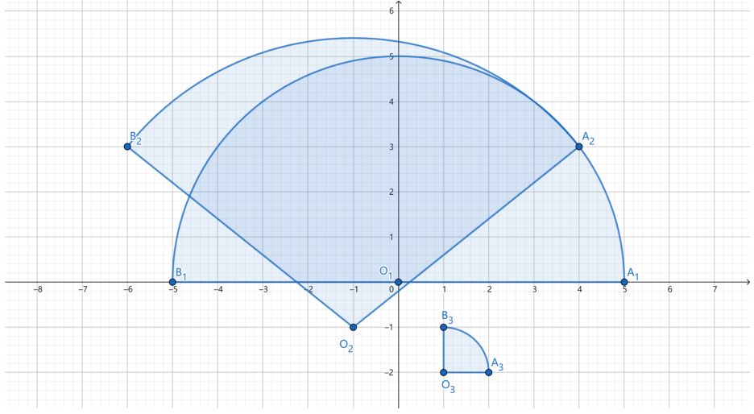

> QOJ 将此版本标注为 AI 翻译，可能存在不准确之处；有疑问时请核对原文。

## 题目描述

时间限制：6.0 秒；内存限制：512 MB。

给定 $n$ 个非退化的扇形，满足以下保证：

-   中心角小于或等于 180 度。
-   不存在两个半径和圆心完全相同的扇形。
-   如果两个扇形存在共线的半径，它们不会共享任何点。

请计算这些扇形并集的面积。

## 输入格式

第一行包含一个整数 $n$ ($1 \le n \le 1000$)，表示扇形的数量。

接下来 $n$ 行，第 $i$ 行包含六个整数 $x_{i,o}, y_{i,o}, x_{i,a}, y_{i,a}, x_{i,b}, y_{i,b}$ ($-10^4 \le x_{i,o}, y_{i,o}, x_{i,a}, y_{i,a}, x_{i,b}, y_{i,b} \le 10^4$)，分别表示第 $i$ 个扇形的圆心 $O_i(x_{i,o}, y_{i,o})$ 以及两个端点 $A_i(x_{i,a}, y_{i,a})$ 和 $B_i(x_{i,b}, y_{i,b})$ 的坐标。第 $i$ 个扇形定义为线段 $O_iA_i$ 绕点 $O_i$ 逆时针旋转至 $O_iB_i$ 所经过的区域。保证：

-   $O_i, A_i$ 和 $B_i$ 不会重合。
-   $|O_iA_i| = |O_iB_i|$。
-   $\vec{O_iA_i} \times \vec{O_iB_i} \ge 0$，其中 $\times$ 表示二维向量的叉积模，定义为 $a \times b = a.x \cdot b.y - a.y \cdot b.x$。等号成立当且仅当两个向量方向相反。

## 输出格式

输出这些扇形并集的面积，保留为单行上的一个十进制数。如果你的答案与标准答案的绝对误差或相对误差不超过 $10^{-6}$，则视为正确。

## 样例

### 输入 1

```text
3
0 0 5 0 -5 0
-1 -1 4 3 -6 3
1 -2 2 -2 1 -1
```

### 输出 1

```text
47.9378026054
```

### 输入 2

```text
1
0 0 -10000 -10000 10000 10000
```

### 输出 2

```text
314159265.3589793238
```

## 说明

第一个测试用例可以用下图表示：



---

来源：[QOJ 中文题面](https://qoj.ac/problem/6813/statement/zh_cn)。保留 QOJ 提供的中文内容，仅转换为 Markdown 排版；原题及图示版权归原作者所有。 QOJ 中文页中的失效图片已按原有顺序补为[官方英文题面](https://qoj.ac/download.php?type=attachments&id=1303&r=0)中的对应图示。
