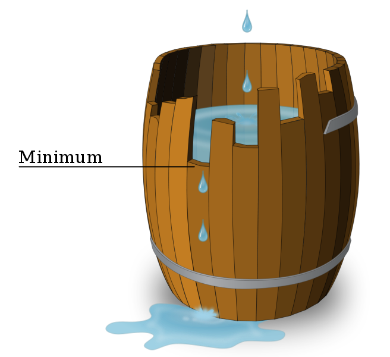

## 题目描述

时间限制：2.0 秒；内存限制：512 MB。

中国孩子或多或少都听说过“木桶理论”——木桶的容量不取决于最长的木板，而取决于最短的那块，如下图所示。



Minimum

老师和家长们倾向于用这个理论来强调全面发展、素质教育或集体主义的重要性。然而，Little Desprado2 和 Foolish Timsei 对此理论持不同意见。在他们看来，一个好的木桶不仅取决于容量，还取决于外观。

根据木桶理论，如果一个木桶由 $n$ 块长度为正整数的木板 $a_1, a_2, \dots, a_n$ 组成，那么木桶的容量为 $\min_{i=1}^n a_i$。他们定义木桶的“丑陋度”为 $a_1 \oplus a_2 \oplus \dots \oplus a_n$，其中 $\oplus$ 表示按位异或（XOR）。他们认为，当且仅当木桶的丑陋度小于其容量时，这个木桶是“好的”。

现在，Foolish Timsei 和 Little Desprado2 有一根长度为 $m$ 的长木板，他们想将其切割成 $n$ 块，组成一个“好的”木桶，且总长度保持不变。请帮他们找到一个合法的切割方案！

## 输入格式

第一行包含一个整数 $T$ ($1 \le T \le 10^5$)，表示测试用例的数量。

每个测试用例包含两个整数 $n$ 和 $m$ ($1 \le n \le 10^5, n \le m \le 10^7$)，分别表示切割后的木板数量和初始木板的长度。

保证所有测试用例中 $n$ 的总和不超过 $3 \times 10^5$；所有测试用例中 $m$ 的总和不超过 $10^7$。

## 输出格式

对于每个测试用例：

-   如果存在切割方案，输出一行 “YES”，随后输出一行由空格分隔的 $n$ 个整数 $a_1, a_2, \dots, a_n$，表示 $n$ 块木板的长度。如果存在多种方案，输出任意一种即可。
-   否则，输出一行 “NO”。

## 样例

### 样例输入 1

```text
3
6 7
5 17
4 4
```

### 样例输出 1

```text
NO
YES
2 2 2 4 7
YES
1 1 1 1
```
