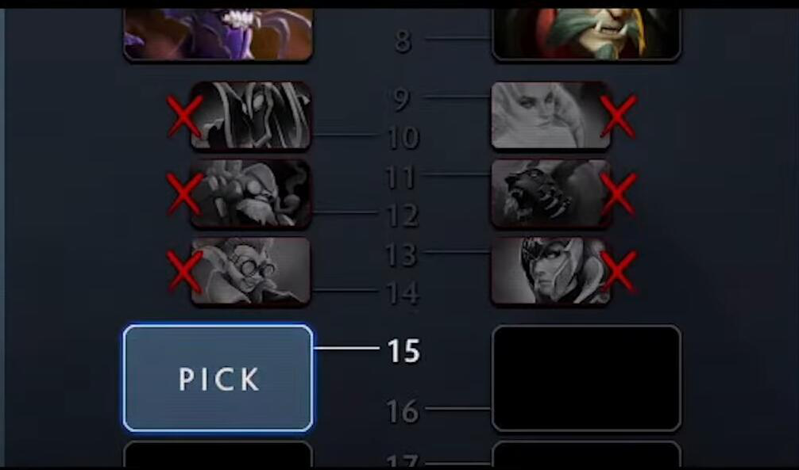

## 题目描述

时间限制：4.0 秒；内存限制：1024 MB。

Bobo 最近刚学会玩 Dota2。在 Dota2 比赛中，英雄的禁用/选择机制被引入，为了方便本题，将其简化如下：

假设两支队伍 Team A 和 Team B 进行一场游戏。每支队伍都有一个包含 $n$ 个英雄的英雄池，其效用分数分别为 $a_1, \dots, a_n$ 和 $b_1, \dots, b_n$。这里我们假设两支队伍英雄池中的所有英雄都是不同的。

两支队伍轮流进行禁用/选择操作，Team A 先手。在每一轮中，队伍可以选择一个英雄加入自己的阵容，或者禁用对手英雄池中一个尚未被选择的英雄。

在 $2n$ 轮操作后，所有英雄要么被选择，要么被禁用。随后，每支队伍需要从自己选择的所有英雄中挑选至多 $k$ 个英雄组成战队，战队的得分为其中所有英雄效用分数之和。

设 $s_A$ 和 $s_B$ 分别为 Team A 和 Team B 组成的战队的得分。Team A 希望最大化 $s_A - s_B$ 的值，而 Team B 希望最小化该值。

Bobo 想知道，如果双方都采取最优策略，最终的 $s_A - s_B$ 的值是多少？他不擅长计算，所以向你寻求帮助。



Dota2 中禁用/选择英雄的示例。来源：TI10 True Sight

## 输入格式

第一行包含两个整数 $n, k$ ($1 \le n \le 10^5, 1 \le k \le 10$)。 第二行包含 $n$ 个整数 $a_1, a_2, \dots, a_n$ ($1 \le a_i \le 10^8$)，表示 Team A 的英雄效用分数。 第三行包含 $n$ 个整数 $b_1, b_2, \dots, b_n$ ($1 \le b_i \le 10^8$)，表示 Team B 的英雄效用分数。

## 输出格式

输出一行一个整数，表示答案。

## 样例

### 输入 1

```text
2 1
3 6
2 4
```

### 输出 1

```text
2
```

### 输入 2

```text
4 1
1 3 5 7
2 4 6 8
```

### 输出 2

```text
0
```

### 输入 3

```text
4 2
4 6 7 9
2 5 8 10
```

### 输出 3

```text
3
```
