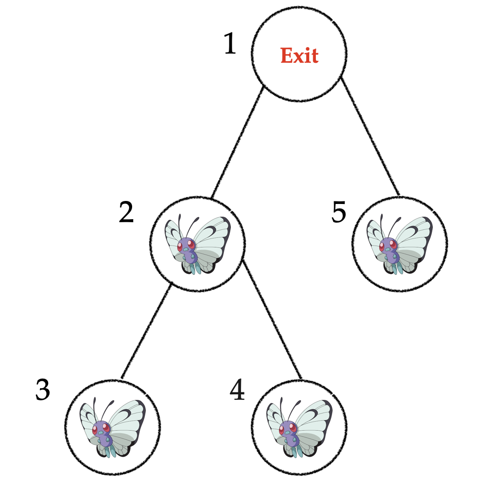
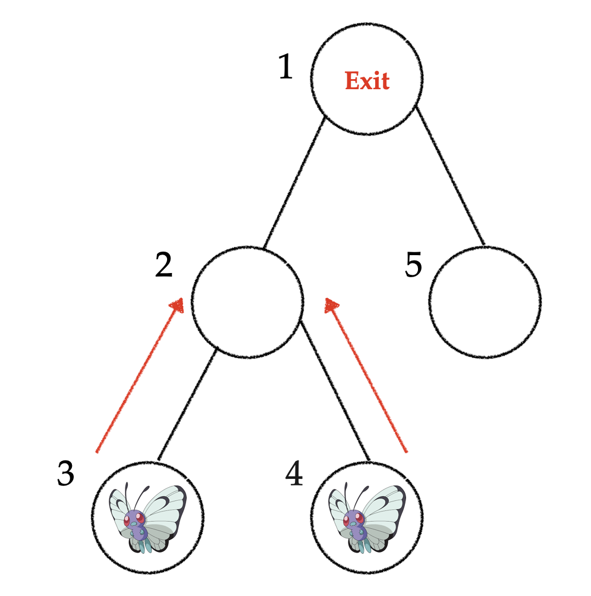
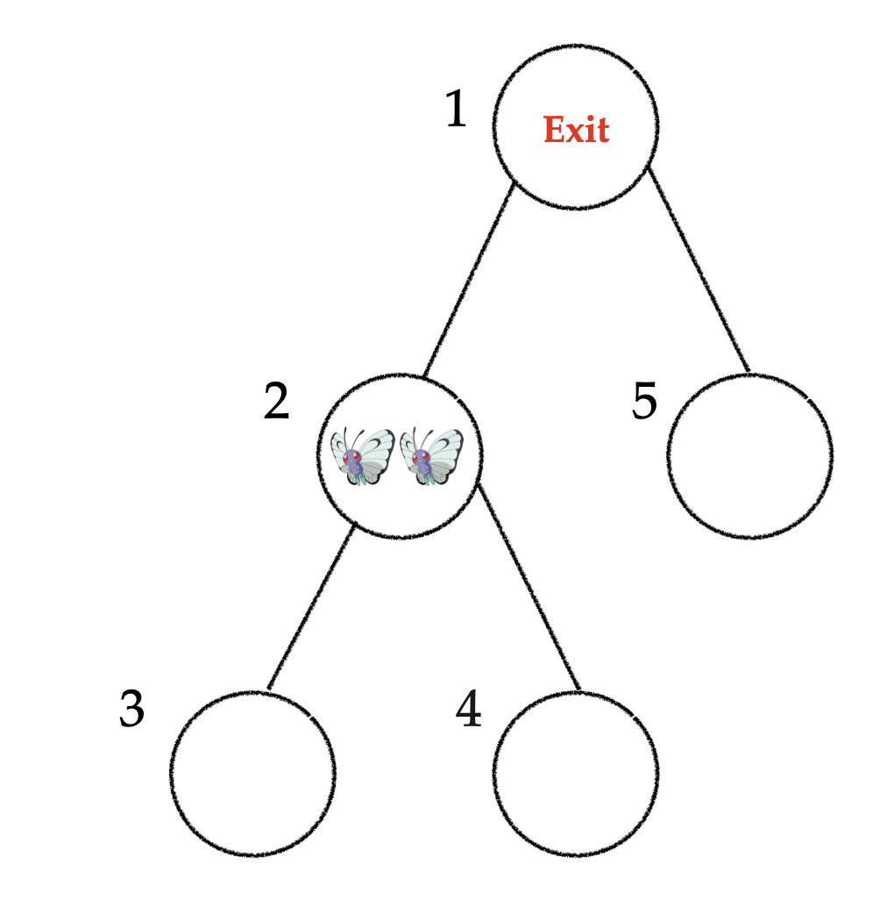

## 题目描述

时间限制：1.0 秒；内存限制：1024 MB。

Bobo 在听《Song from a secret garden》时，不小心掉进了秘密花园。猜猜他看到了什么？蝴蝶！


是的，就是它。

秘密花园的结构可以建模为一棵包含 $n$ 个节点的无向树，节点编号从 $1$ 到 $n$，其中编号为 $1$ 的节点是秘密花园的出口。最初，编号为 $2$ 到 $n$ 的每个节点上都有一只蝴蝶。Bobo 注意到，每一分钟，每只蝴蝶都会沿着边向编号为 $1$ 的节点方向移动。当蝴蝶飞到编号为 $1$ 的节点时，它就会离开秘密花园并永远消失。

Bobo 想要在所有蝴蝶飞到出口并消失之前抓住它们。Bobo 最初不在树的任何节点上。他可以在某一分钟（包括第 $0$ 分钟，此时所有蝴蝶都在它们各自的初始节点上）选择树上的任意节点，并抓住该节点上的所有蝴蝶（Bobo 不能在节点 $1$ 处抓蝴蝶，因为蝴蝶到达那里时会瞬间消失）。这算作一次操作。Bobo 动作非常快，他进行操作所需的时间可以忽略不计。Bobo 想知道，他最少需要进行多少次操作才能抓住所有蝴蝶？


一定要抓住它们！

## 输入格式

第一行包含一个整数 $n$ ($1 \le n \le 10^5$)，表示树中的节点数。

接下来 $n - 1$ 行，每行包含两个整数 $u, v$ ($1 \le u, v \le n, u \neq v$)，表示树中的一条边。

保证输入构成一棵合法的树。

## 输出格式

输出一行一个整数，表示 Bobo 抓住所有蝴蝶所需的最少操作次数。

## 样例

### 输入 1

```text
5
1 2
2 3
2 4
1 5
```

### 输出 1

```text
3
```

## 说明

对于第一个样例测试用例，第 $0$ 分钟的初始状态如下：



在第 $0$ 分钟，Bobo 必须在节点 $2$ 和节点 $5$ 执行操作，否则这两个节点上的蝴蝶将在下一分钟到达出口。



最初位于节点 $3$ 和 $4$ 的两只蝴蝶都在第 $1$ 分钟到达节点 $2$。然后 Bobo 可以在节点 $2$ 执行一次操作，将它们一并抓住。总共需要三次操作。


