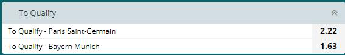

> QOJ 将此版本标注为 AI 翻译，可能存在不准确之处；有疑问时请核对原文。

## 题目描述

时间限制：5.0 秒；内存限制：1024 MB。

Bobo United (BU) 和 Bobo City (BC) 之间的足球比赛即将开始。作为一家博彩公司的赔率编制员，Bobo 需要为每支球队设定赔率。

共有 $n$ 名赌徒准备在这场比赛中下注，每位赌徒对 BU 获胜的概率都有一个估计值 $p_i$。在此，我们考虑博彩公司预先收集了所有赌徒信息的情况，因此每个 $p_i$ 都是已知的。

如果你为 BU 设定的赔率为 $x$，为 BC 设定的赔率为 $y$，那么对于每位赌徒 $i$：

-   如果 $p_i \cdot x \ge 1$，他/她将投注 $c_i$ 美元在 BU 上。
-   否则，如果 $(1 - p_i) \cdot y \ge 1$，他/她将投注 $c_i$ 美元在 BC 上。

假设投注在 BU 上的总金额为 $s_x$ 美元，投注在 BC 上的总金额为 $s_y$ 美元。如果最终 BU 赢得比赛，公司需要赔付 $s_x \cdot x$ 美元；如果 BC 赢得比赛，公司需要赔付 $s_y \cdot y$ 美元。在最坏的情况下，博彩公司的利润为 $s_x + s_y - \max(s_x \cdot x, s_y \cdot y)$ 美元（利润可能是负数，意味着公司实际上亏损了）。

Bobo 需要设定 $x$ 和 $y$ 的值，以最大化最坏情况下的利润，否则他可能会被公司解雇。你能帮帮他吗？



在线博彩公司提供的赔率示例。来源：某个神秘网站

## 输入格式

第一行包含一个整数 $n$ ($1 \le n \le 10^6$)，表示赌徒的人数。

接下来 $n$ 行。第 $i$ 行 ($1 \le i \le n$) 包含一个实数 $p_i$ 和一个整数 $c_i$ ($0 \le p_i \le 1, 1 \le c_i \le 10^8$)，其含义已在题目描述中给出。保证 $p_i$ 小数点后最多有 6 位数字。

## 输出格式

输出一行一个数字，表示博彩公司通过最优设定 $x$ 和 $y$ 的值，在最坏情况下能获得的最大利润。如果你的答案与标准答案的绝对误差或相对误差不超过 $10^{-6}$，则视为正确。形式化地，设你的答案为 $a$，标准答案为 $b$，若满足 $\frac{|a-b|}{\max(b,1)} \le 10^{-6}$，则你的答案被视为正确。

## 样例

### 样例输入 1

```text
2
1 15
0 10
```

### 样例输出 1

```text
10.0000000000
```

### 样例输入 2

```text
3
0.4 100
0.5 100
0.6 100
```

### 样例输出 2

```text
33.3333333333
```

---

来源：[QOJ 中文题面](https://qoj.ac/problem/8037/statement/zh_cn)。保留 QOJ 提供的中文内容，仅转换为 Markdown 排版；原题及图示版权归原作者所有。
