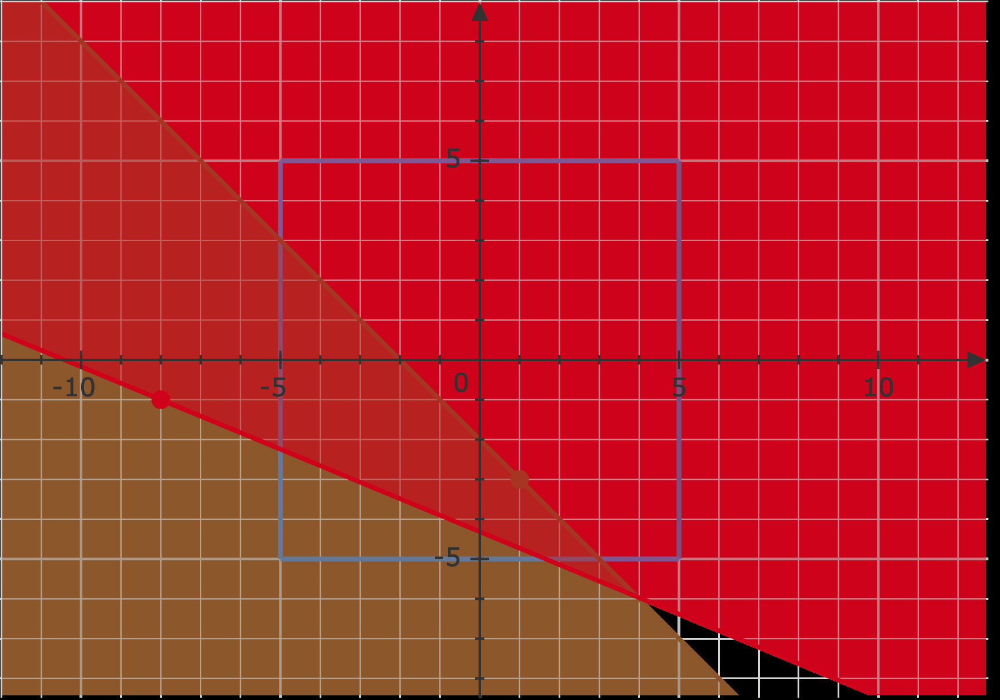

## 题目描述

时间限制：3.0 秒；内存限制：1024 MB。

Bobotown 和 Boboland 之间的争端几十年来一直未能解决。作为 Bobotown 的总理，Bobo 下令部署 $n$ 个新开发的武器，它们分别位于 $(x_1, y_1), (x_2, y_2), \dots, (x_n, y_n)$。第 $i$ 个武器的覆盖范围由一个可调的整数参数 $k_i$ ($0 \le k_i < 2m$) 决定。具体来说，参数为 $k_i$ 的第 $i$ 个武器的覆盖范围是所有满足以下条件的点 $(x, y)$：


$$
x \cos \frac{k_i}{m} \pi + y \sin \frac{k_i}{m} \pi \ge x_i \cos \frac{k_i}{m} \pi + y_i \sin \frac{k_i}{m} \pi
$$


Boboland 的领土是一个以原点为中心、边长为 $2R$ 的轴对齐正方形。Bobo 现在想知道，有多少种整数参数 $k_1, k_2, \dots, k_n$ 的选择方案，使得 Boboland 的领土被这些武器完全覆盖；更准确地说，Boboland 领土内的每一个点都在至少一个已部署武器的覆盖范围内。作为 Bobotown 的副总理，你需要完成所有的计算。

答案可能非常巨大，请输出答案对 $998\,244\,353$ 取模后的结果。

## 输入格式

第一行包含三个整数 $n, m, R$ ($1 \le n \le 100, 1 \le m, R \le 10$)，含义如上所述。

接下来的 $n$ 行中，第 $i$ 行包含两个整数 $x_i, y_i$ ($-10 \le x_i, y_i \le 10$)，表示第 $i$ 个武器的位置。

## 输出格式

输出一行一个整数，表示答案对 $998\,244\,353$ 取模后的结果。

## 样例

### 输入 1

```text
2 8 5
1 -3
-8 -1
```

### 输出 1

```text
71
```

### 输入 2

```text
1 8 8
1 2
```

### 输出 2

```text
0
```

## 说明

对于第一个样例，参数的一种可能选择是 $10$ 和 $3$，如下图所示。



对于第二个样例，不存在满足要求的参数。
