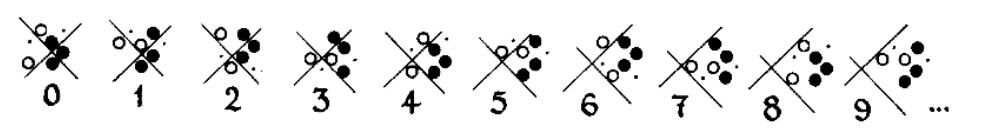

> QOJ 将此版本标注为 AI 翻译，可能存在不准确之处；有疑问时请核对原文。

## 题目描述

时间限制：1.0 秒；内存限制：1024 MB。

数学家和理论计算机科学家对“生命游戏”（Game of Life）的奥秘着迷。他们提出了这样一个问题：“给定一个生命游戏的初始状态，我们能否判定它最终是否会消亡？即是否存在某个有限的数 $t$，使得在第 $t$ 代时没有任何存活的细胞？”然而，事实证明，这个问题不仅是 NP-hard 的，甚至是不可判定的。在生命游戏中，可以构建出一种模式，其作用类似于连接了两个计数器的有限状态机。这与通用图灵机具有相同的计算能力，因此生命游戏在理论上与任何拥有无限内存且无时间限制的计算机一样强大；它是图灵完备的。事实上，人们已经在生命游戏中实现了几种不同的可编程计算机架构，包括一种模拟俄罗斯方块的模式。

尽管上述事实表明我们永远无法揭开生命游戏的奥秘，但我们仍然可以做一些事情。构造就是其中之一，这也正是本题所要求的内容：

给定一个正整数 $k$ ($1 \le k \le 100$)，请构造一个生命游戏的初始状态，使得所有存活细胞的坐标均为不超过 $300$ 的正整数，且该配置恰好持续 $k$ 代。也就是说，在第 $k-1$ 代存在存活细胞，而在第 $k$ 代没有任何存活细胞。题目保证至少存在一个这样的初始配置。

## 输入格式

输入仅包含一个整数 $k$ ($1 \le k \le 100$)，表示该配置需要持续的代数。

## 输出格式

第一行包含一个整数 $n$ ($1 \le n \le 90000$)，表示你构造的初始状态中存活细胞的数量。

接下来 $n$ 行，每行包含两个整数 $x, y$ ($1 \le x, y \le 300$)，表示初始状态中一个存活细胞的坐标。每个存活细胞的坐标应仅输出一次。

如果存在多种可能的初始配置，输出其中任意一种均被视为正确。

## 样例

### 样例输入 1

```text
1
```

### 样例输出 1

```text
1
1 1
```

### 样例输入 2

```text
2
```

### 样例输出 2

```text
3
100 100
101 100
102 99
```



Figure 1. Evolution of a pattern in the Game of Life

---

来源：[QOJ 中文题面](https://qoj.ac/problem/8041/statement/zh_cn)。保留 QOJ 提供的中文内容，仅转换为 Markdown 排版；原题及图示版权归原作者所有。
