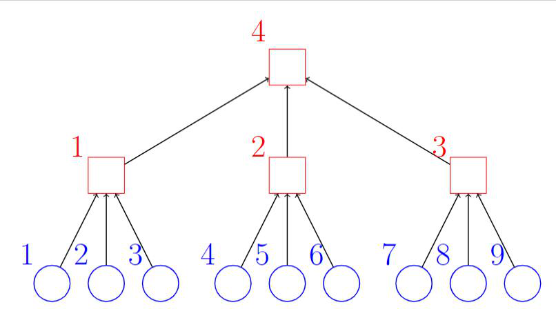
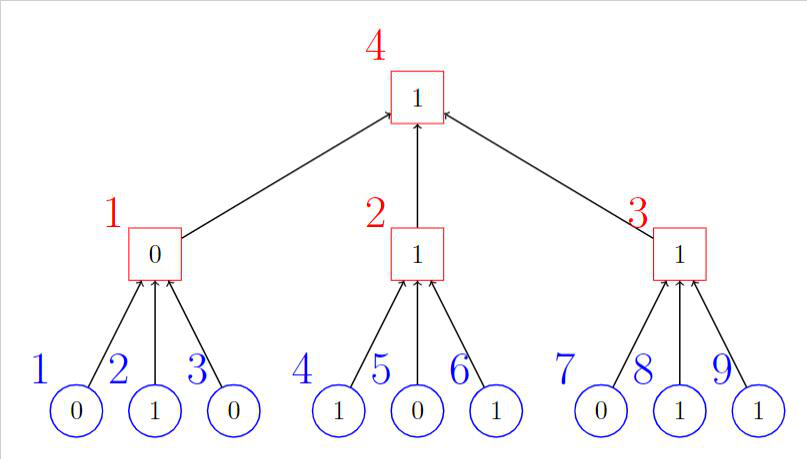
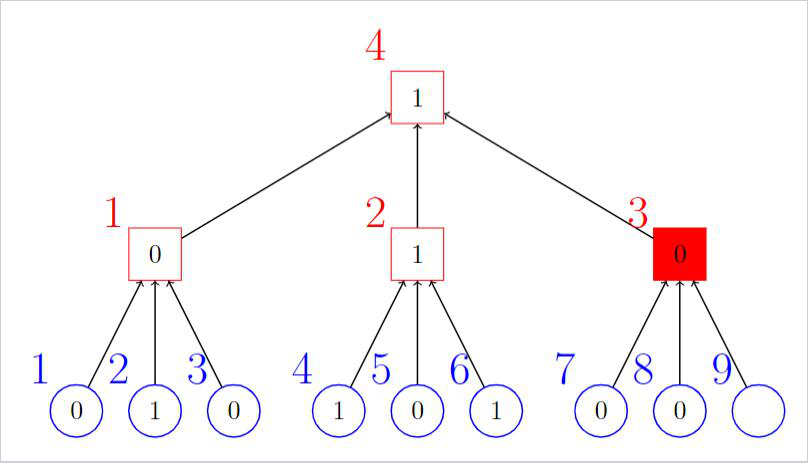

> QOJ 将此版本标注为 AI 翻译，可能存在不准确之处；有疑问时请核对原文。

## 题目描述

时间限制：2.0 秒；内存限制：1024 MB。

Bobo 是著名电视节目“Sunday Night Live”的导演。该节目最近推出了一个名为“World Debate”的新环节，自首次亮相以来就广受好评。尽管名字听起来有些令人生畏，但这其实是一个观众就特定议题进行投票的环节。具体来说，节目组会选择一个有争议的议题，观众投 0 票（表示“不同意”）或 1 票（表示“同意”）。这些投票随后会被收集起来，以产生关于该议题的最终意见。

使该环节脱颖而出的是投票机的使用。投票机是一种自动系统，它接收奇数个 $\{0, 1\}$ 输入，并将接收到的输入中的多数值作为输出。注意，投票机不需要接收所有输入即可产生输出。一旦投票机接收到相同值的数量超过其输入槽位的一半，它就会立即产生该值作为输出。

节目组随后使用这些投票机来产生结果。假设有 $n$ 名观众，编号从 $1$ 到 $n$，以及 $m$ 台投票机，编号从 $1$ 到 $m$。最终意见将按以下方式产生：

-   所有观众按 $1$ 到 $n$ 的顺序投票。
-   每台投票机从某位观众的投票或编号比它小的投票机的输出中获取输入。
-   每位观众的投票和除编号为 $m$ 的投票机之外的每台投票机的输出，都恰好作为一台投票机的输入。
-   编号为 $m$ 的投票机的输出将被视为最终意见。

作为导演，Bobo 并不太关心最终结果。他只关心节目的收视率。他想创造一种被称为“Por Una Cabeza”的紧张状态，使得对于每一台投票机，它在接收到所有输入之前都不会产生输出。如果所有观众都按照自己的意愿投票，这可能无法实现，但 Bobo 可以做出改变。Bobo 知道编号为 $i$ ($1 \le i \le n$) 的观众的投票 $a_i$，以及 Bobo 需要支付的让该观众改变投票的成本 $b_i$。在预算相当紧张的情况下，Bobo 想知道实现“Por Una Cabeza”的最小成本。

但是等等！电视节目是直播的，所以情况可能会发生变化。$a_i$ 和 $b_i$ 总共会经历 $q$ 次永久性更改，Bobo 需要知道每次更改后实现“Por Una Cabeza”的最小成本。Bobo 为这个节目投入了太多精力，已经非常疲惫了。你能帮帮他吗？

## 输入格式

第一行包含两个整数 $n, m, q$ ($1 \le n, m, q \le 10^5$)，分别表示观众人数、投票机数量和更改次数。

接下来 $n$ 行。第 $i$ 行 ($1 \le i \le n$) 包含两个整数 $a_i, b_i$ ($a_i \in \{0, 1\}, 1 \le b_i \le 10^9$)，表示第 $i$ 位观众的投票和改变该投票所需的成本。

然后是 $m$ 台投票机的输入描述，按 $1$ 到 $m$ 的顺序排列。每台投票机的输入由一行形式为 $\ell, c_1, c_2, \dots, c_\ell$ ($1 \le \ell \le n + m - 1, -m \le c_i \le n, c_i \neq 0, c_i$ 两两不同，$\ell$ 为奇数) 的数据描述，其中 $c_i > 0$ 表示编号为 $c_i$ 的观众的投票被用作当前投票机的输入，$c_i < 0$ 表示编号为 $-c_i$ 的投票机的输出被用作当前投票机的输入。

接下来 $q$ 行描述更改。每行形式为 $x, y, z$ ($1 \le x \le n, y \in \{0, 1\}, 1 \le z \le 10^9$)，表示 $a_x$ 将变为 $y$，$b_x$ 将变为 $z$。该更改是永久性的，意味着在查询后不会立即回滚。

保证每台投票机从某位观众的投票或编号比它小的投票机的输出中获取输入。 保证每位观众的投票和除编号为 $m$ 的投票机之外的每台投票机的输出，都恰好作为一台投票机的输入。

## 输出格式

在每次 $q$ 次更改后，输出一行一个数字，表示 Bobo 实现“Por Una Cabeza”的最小成本。可以证明，在给定的输入约束下，Bobo 总是有可能实现“Por Una Cabeza”。

## 样例

### 样例输入 1

```text
3 1 5
0 2
1 3
0 2
3 1 2 3
2 0 3
2 0 3
2 1 3
1 1 1
3 1 1
```

### 样例输出 1

```text
2
2
0
1
1
```

### 样例输入 2

```text
9 4 9
0 1
1 2
0 3
1 4
0 5
1 6
0 7
1 8
0 9
3 1 3 2
3 6 4 5
3 9 8 7
3 -1 -2 -3
9 1 4
8 0 6
7 0 3
6 0 8
5 1 5
4 0 7
3 1 2
2 0 9
1 1 1
```

### 样例输出 2

```text
0
6
3
6
10
6
3
4
3
```

## 说明

这里是第二个样例测试中由观众和投票机形成的结构示例，其中圆圈代表观众，方块代表投票机，两者都标有相应的编号，箭头的起点输出作为箭头的终点输入。注意，4 号机器的输出将作为最终结果产生。



第二个样例测试中的结构

第一次更改后，结果如下图所示。这里对于每一台投票机，它在接收到所有输入之前都不会产生输出。因此“Por Una Cabeza”已经实现，不需要改变任何人的投票，因此最小成本为 0。



第二个样例测试，第一次更改后

第二次更改后，结果如下图所示。这里在第 8 位观众投票后，第三台投票机的结果已经确定，而没有接收到其所有输入，因此“Por Una Cabeza”未实现，Bobo 改变第 8 位观众的投票是最优的，在此次更改后成本正好为 6。



第二个样例测试，第二次更改后
