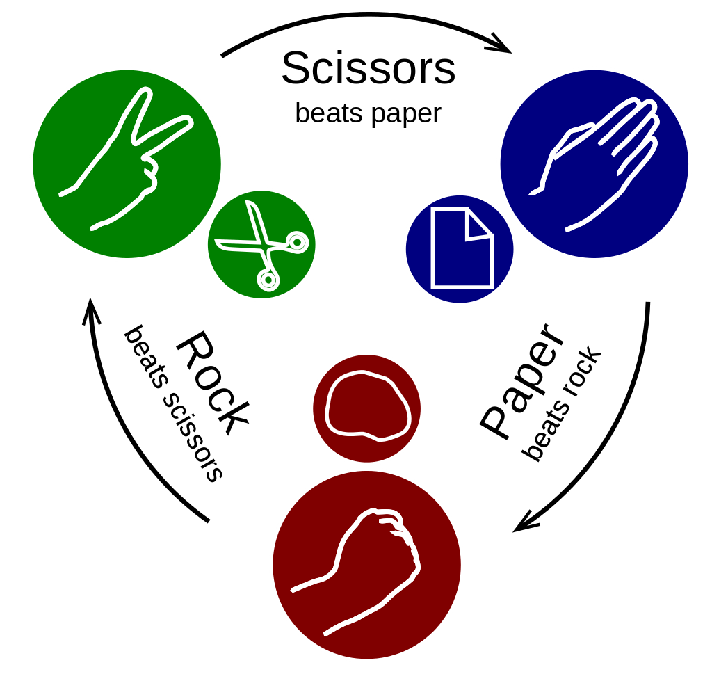
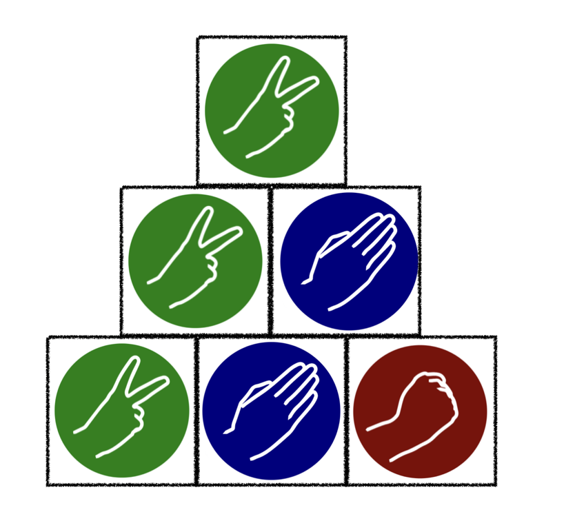
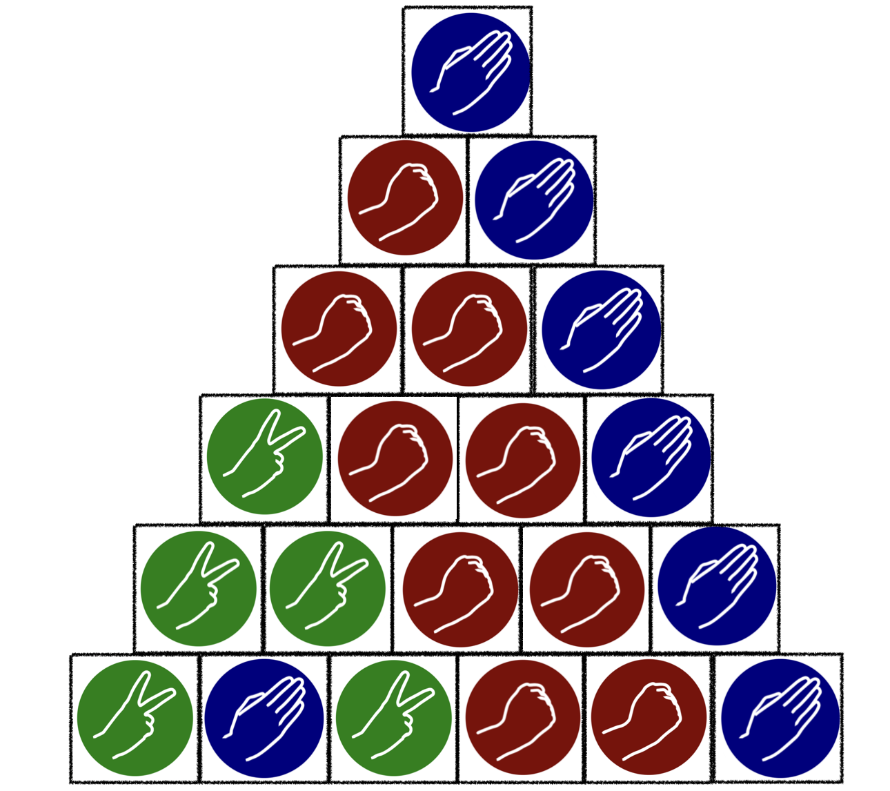

> QOJ 将此版本标注为 AI 翻译，可能存在不准确之处；有疑问时请核对原文。

## 题目描述

时间限制：1.0 秒；内存限制：1024 MB。

石头剪刀布是一种起源于中国的著名手势游戏，通常由两人进行，每人同时用伸出的手做出三种形状之一。这些形状分别是“石头”（握紧的拳头）、“布”（平摊的手掌）和“剪刀”（伸出食指和中指，形成 V 字的拳头）。“剪刀”与两指的 V 字手势（也表示“胜利”或“和平”）相同，只是它是横向指向的，而不是竖直向上。规则很简单：布包石头，石头砸剪刀，剪刀剪布。



石头剪刀布示例。来源：维基百科

我们使用大写字母 R、P 和 S 分别代表石头、布和剪刀。给定一个长度为 $n$ 的初始字符串 $s$，其中包含 R、P 和 S。Bobo 设计了一个高度和底边长均为 $n$ 的“石头剪刀布”金字塔，构造如下：将初始字符串 $s$ 按顺序放置在金字塔底部的 $n$ 个方块中，然后金字塔按照以下规则演化：

-   如果一个方块正下方的两个方块形状相同（即均为 R、P 或 S），则该方块放置相同的形状。
-   如果一个方块正下方的两个方块形状不同，则该方块放置获胜的形状。

请参考说明部分的图片以获得更直观的理解。

Bobo 想知道，遵循此规则，金字塔顶端的形状是什么？

## 输入格式

第一行包含一个整数 $T$，表示测试用例的数量。

对于每个测试用例，给定一个长度为 $s(1 \le |s| \le 10^6)$ 的字符串，仅包含符号 'R'、'P' 和 'S'，作为金字塔底部的配置。

保证所有字符串的长度之和不超过 $10^6$。

## 输出格式

对于每个测试用例，输出一行一个字符 $c \in \{'R', 'P', 'S'\}$，表示金字塔顶端的形状。

## 样例

### 输入 1

```text
2
SPR
SPSRRP
```

### 输出 1

```text
S
P
```

## 说明

下图展示了以字符串 SPR 为初始状态的示例，即样例中的第一个测试用例。



下图展示了以字符串 SPSRRP 为初始状态的示例，即样例中的第二个测试用例。



---

来源：[QOJ 中文题面](https://qoj.ac/problem/8046/statement/zh_cn)。保留 QOJ 提供的中文内容，仅转换为 Markdown 排版；原题及图示版权归原作者所有。
