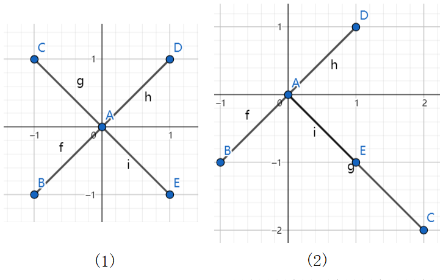

> QOJ 将此版本标注为 AI 翻译，可能存在不准确之处；有疑问时请核对原文。

## 题目描述

时间限制：1.0 秒；内存限制：256 MB。

兔子查尔斯喜欢吃草。俗话说，兔子不吃窝边草。因此，查尔斯每天都必须离开洞穴去寻找草吃。

有一天，查尔斯来到一个二维平面上，那里有许多不同的点。他可以选择一个点 $A$ 和另外四个点 $B, C, D, E$，并将它们与 $A$ 连接起来形成四条线段。如果这四条线段满足以下条件，我们就称它们为一簇草：

-   这四条线段中任意两条线段的交点仅为 $A$。

例如，在下图中，(1) 是一簇草，但 (2) 不是，因为线段 $AC$ 和 $AE$ 的交点不仅仅是点 $A$。



给定平面上的 $n$ 个点，查尔斯想知道是否存在一簇草。如果存在，请帮他找出其中一簇。

## 输入格式

第一行包含一个整数 $T$ ($1 \le T \le 120$)，表示测试用例的数量。 每个测试用例的第一行包含一个整数 $n$ ($1 \le n \le 25000$)，表示点的数量。 接下来的 $n$ 行，每行包含两个整数 $x, y$ ($-10^7 \le x, y \le 10^7$)，表示点的坐标 $(x, y)$。保证所有点互不相同。 保证所有测试用例的 $n$ 之和不超过 $10^5$。

## 输出格式

对于每个测试用例，如果不存在一簇草，则输出一行 `NO`。 否则，第一行输出 `YES`。第二行输出两个整数，用空格分隔，表示点 $A$ 的坐标。接下来的第三至第六行，每行输出两个整数，用空格分隔，分别表示另外四个点 $B, C, D, E$ 的坐标。 如果存在多簇草，输出任意一簇即可。

## 样例

### 输入格式 1

```text
3
5
0 0
1 1
1 -1
-1 1
-1 -1
3
1 1
4 5
1 4
5
1 0
2 0
3 0
4 0
5 0
```

### 输出格式 1

```text
YES
0 0
1 1
1 -1
-1 1
-1 -1
NO
NO
```

---

来源：[QOJ 中文题面](https://qoj.ac/problem/9593/statement/zh_cn)。保留 QOJ 提供的中文内容，仅转换为 Markdown 排版；原题及图示版权归原作者所有。 QOJ 中文页中失效或错配的图片已按原有顺序补为[官方英文题面](https://qoj.ac/download.php?type=statement&id=9593&ver=default)中的对应图示。
