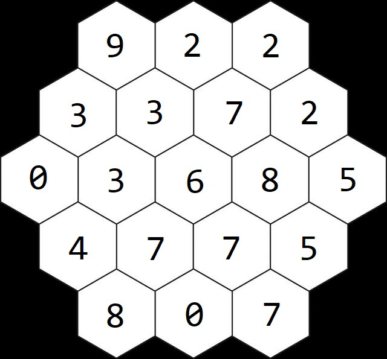
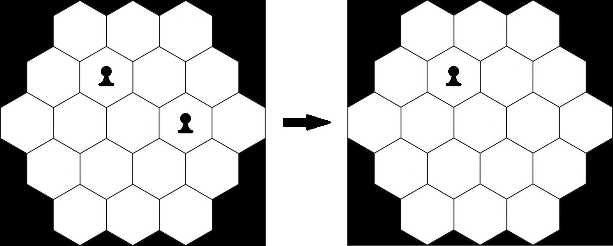
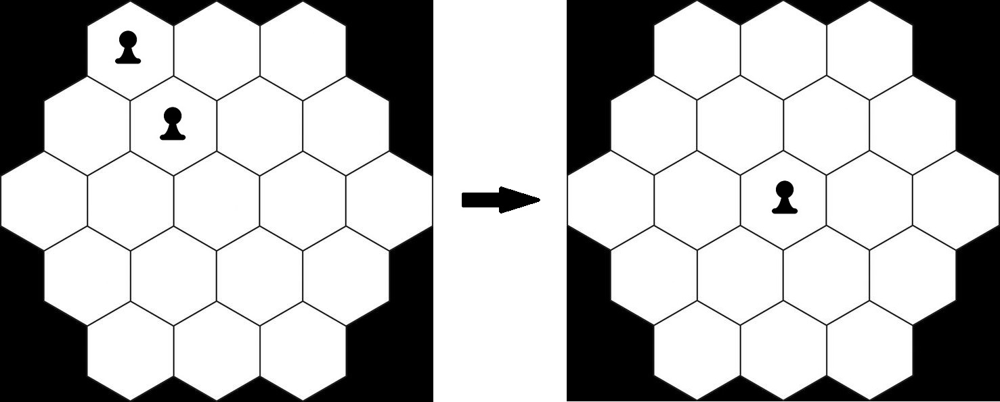
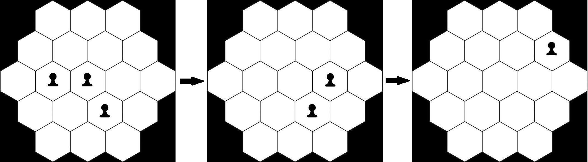

> QOJ 将此版本标注为 AI 翻译，可能存在不准确之处；有疑问时请核对原文。

## 题目描述

时间限制：2.0 秒；内存限制：512 MB。

小狗 Pico 和 FuuFuu 以及 Kotsuki 住在一起。他们经常一起玩一种叫做 Sternhalma 的棋盘游戏，也就是大家熟知的中国跳棋。游戏的目标是通过单步移动或跳过其他棋子，将自己所有的棋子移动到六角星形棋盘的对面。

有一天，Pico 想再玩一次 Sternhalma，但 Kotsuki 出去工作了，FuuFuu 还在睡觉。感到无聊的 Pico 打算自己玩一会儿。Pico 将棋盘简化为下图所示的形状，共有 19 个格子，并为每个格子分配了一个分数。



起初，他在棋盘上放置了一些棋子。然后，他按照自己设定的规则移动棋子，每回合选择以下两种移动方式之一：

-   直接从棋盘上移除任意一个棋子，不获得分数。



-   通过跳过棋子来移除一个棋子。形式化地说，对于两个相邻的棋子 $A$ 和 $B$，如果 $A$ 关于 $B$ 的对称位置没有出界且没有放置棋子，那么 $A$ 可以跳过 $B$，同时 $B$ 被从棋盘上移除。总分将增加 $B$ 在被移除前所在格子的分数。（当且仅当两个棋子所在的格子共享一条边时，我们认为这两个棋子相邻。）



初始分数为 0。Pico 将持续移除棋子，直到棋盘上没有棋子为止。对于不同的初始棋子摆放方式，他想知道他能获得的最高分数。

## 输入格式

前五行包含 19 个整数，表示分配给格子的分数。第一行包含 3 个整数，表示棋盘的第一行；第二行包含 4 个整数，表示棋盘的第二行，以此类推。每个分数在 $-10^6$ 到 $10^6$ 之间。

下一行包含一个整数 $n$ ($1 \le n \le 10^4$)，表示初始摆放方式的数量。

每个初始摆放方式占用五行。每行包含一个仅由 `.` 或 `#` 组成的字符串。第一行包含 3 个字符，表示棋盘的第一行；第二行包含 4 个字符，表示棋盘的第二行，以此类推。`#` 表示该位置有棋子，`.` 表示没有棋子。

## 输出格式

对于每种初始摆放方式，输出一行，包含最高分数。

## 样例

### 输入格式 1

```text
9 2 2
3 3 7 2
0 3 6 8 5
4 7 7 5
8 0 7
3
...
..#.
..##.
....
...
...
....
.##..
..#.
...
###
####
#####
####
###
```

### 输出格式 1

```text
8
14
105
```

### 说明

样例中的第一个初始摆放方式如下图所示。显然，只能通过跳过棋子移除一个棋子。



对于样例中的第二个初始摆放方式，获得最高分数的移动过程如下图所示。


