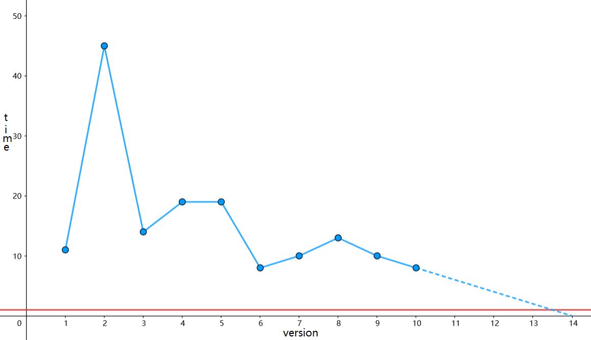

> QOJ 将此版本标注为 AI 翻译，可能存在不准确之处；有疑问时请核对原文。

## 题目描述

时间限制：1.0 秒；内存限制：256 MB。

Little Q 正在学习编程语言。他经常使用 Python，因为它是最常用的编程语言之一。然而，当他用 Python 编写代码时，他发现程序运行效率并不高，尤其是与 C/C++ 相比时。他想知道 Python 的运行效率是否会随着版本更新而有所提高，于是进行了一项实验。

实验中使用的算法是蒙特卡洛算法，通过在正方形内生成大量随机点来估计 $\pi$ 的值。他在 Python 中编写了这个算法，并使用不同版本的 Python 运行它，记录下运行时间。形式化地，总共有 $n$ 个已发布的 Python 版本，即 3.1, 3.2, ..., 3.n。该算法在版本 3.i 上的运行时间为 $a_i$ 毫秒。Little Q 惊讶地发现，Python 的运行效率确实会随着版本迭代而改变。

Little Q 还测试了该算法在 C++ 中的运行时间，稳定为 $k$ 毫秒。接着他产生了一个有趣的想法：利用实验数据来预测未来的哪个 Python 版本效率会高于 C++。遗憾的是，他忘记了如何应用回归模型，因此他使用了一种暴力预测方法：

-   对于 $i > n$ 的未来版本 $i$，$a_i = \max(0, 2a_{i-1} - a_{i-2})$。

利用这种预测方法，请告诉他最早的效率严格高于 C++ 的 Python 版本，即找到满足 $a_i < k$ 的最小 $i$。

## 输入格式

第一行包含两个整数 $n$ 和 $k$ ($2 \le n \le 10, 1 \le k \le 1000$)，分别表示已发布的 Python 版本数量和算法在 C++ 中的运行时间。

第二行包含 $n$ 个整数 $a_1, a_2, \dots, a_n$ ($k < a_i \le 10^5$)，表示算法在每个 Python 版本上的运行时间。

## 输出格式

输出 `Python 3.x will be faster than C++`，其中 $x$ 是满足 $a_x < k$ 的最早版本号。如果不存在这样的版本，则输出 `Python will never be faster than C++`。

## 样例

### 样例输入 1

```text
10 1
11 45 14 19 19 8 10 13 10 8
```

### 样例输出 1

```text
Python 3.14 will be faster than C++
```

### 样例输入 2

```text
10 1
2 2 2 2 2 2 2 2 2 2
```

### 样例输出 2

```text
Python will never be faster than C++
```

## 说明

第一个样例可以用下图表示，其中蓝线代表 Python 的效率，红线代表 C++ 的效率。虚线表示预测值。正如你所见，Python 3.14 的效率将高于 C++。



对于第二个样例，很容易注意到 Python 的运行时间始终为 2 毫秒，包括对未来版本的预测。因此，Python 的效率永远不会高于运行时间为 1 毫秒的 C++。
