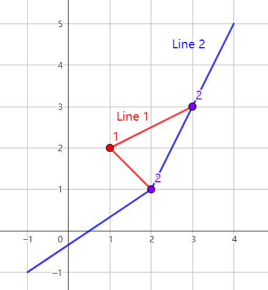

## 题目描述

时间限制：2.0 秒；内存限制：1024 MB。

Grammy 计划在 Pigeland 建造地铁。她选择了 $n$ 个车站，并决定用最少数量的地铁线路将它们连接起来。每条地铁线路包含一个或多个连续的线段，并经过一个或多个车站。一条地铁线路不应经过同一个车站两次。为了增加趣味性，Grammy 决定在最终的地铁规划中，恰好有 $a_i$ 条地铁线路经过第 $i$ 个车站。

形式上，每条地铁线路可以用一系列点 $p_1, p_2, \dots, p_L (L \ge 2)$ 来描述，地铁线路的全程是线段 $[p_1, p_2], [p_2, p_3], \dots, [p_{L-1}, p_L]$ 的并集。位于地铁线路上的每个车站都应位于点 $p_i$ 处，其中 $i \in [1, L]$。注意，点 $p_i$ 不一定是地铁车站。



在这张图片中（展示了样例测试用例），有两条地铁线路。线路 1 经过 3 个车站，线路 2 经过 2 个车站。角落里标有 2 的紫色车站被 2 条地铁线路经过，角落里标有 1 的红色车站被 1 条地铁线路经过。

由于预算限制，地铁线路不应自交，且两条地铁线路不应在车站之外相交。

请帮助 Grammy 找到使用最少地铁线路数量的地铁规划。如果存在多种方案，输出任意一种即可。

为了避免精度问题，你的地铁规划应仅包含整数点作为线段的端点。

## 输入格式

第一行包含一个整数 $n$ ($1 \le n \le 50$)，表示车站的数量。

接下来 $n$ 行，每行包含 3 个整数 $x_i, y_i, a_i$ ($-10^3 \le x_i, y_i \le 10^3, 1 \le a_i \le 50$)，表示第 $i$ 个车站位于位置 $(x_i, y_i)$，且应有恰好 $a_i$ 条地铁线路经过该车站。

保证所有车站的坐标各不相同。

## 输出格式

第一行应包含最少可能的地铁线路数量 $k$。

接下来 $k$ 行，每行包含一条地铁线路的描述，格式如下：

第一个整数 $L$ ($2 \le L$)，表示该地铁线路中端点的总数。

随后是 $L$ 对整数 $x_i, y_i$ ($-10^9 \le x_i, y_i \le 10^9$)，表示该地铁线路的端点。

输出中 $L$ 的总和不应超过 $10^4$。

## 样例

### 输入 1

```text
3
1 2 1
2 1 2
3 3 2
```

### 输出 1

```text
2
3 2 1 1 2 3 3
4 -1 -1 2 1 3 3 4 5
```

### 输入 2

```text
1
1 1 1
```

### 输出 2

```text
1
5 0 0 1 1 2 2 4 4 8 8
```
