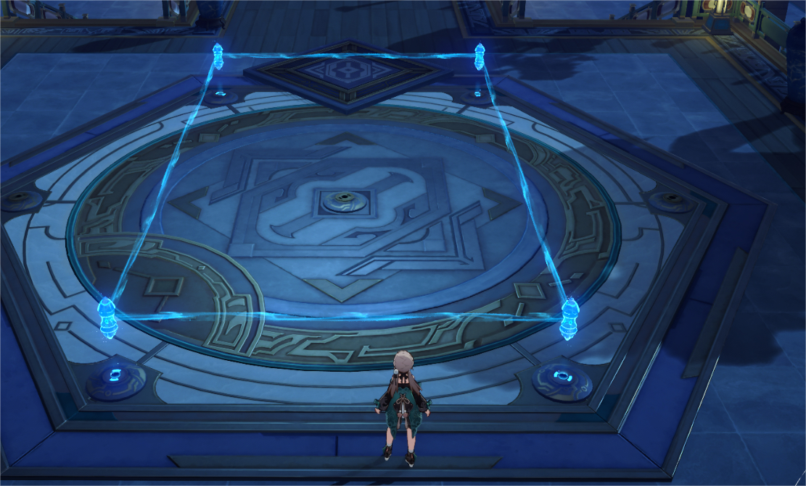
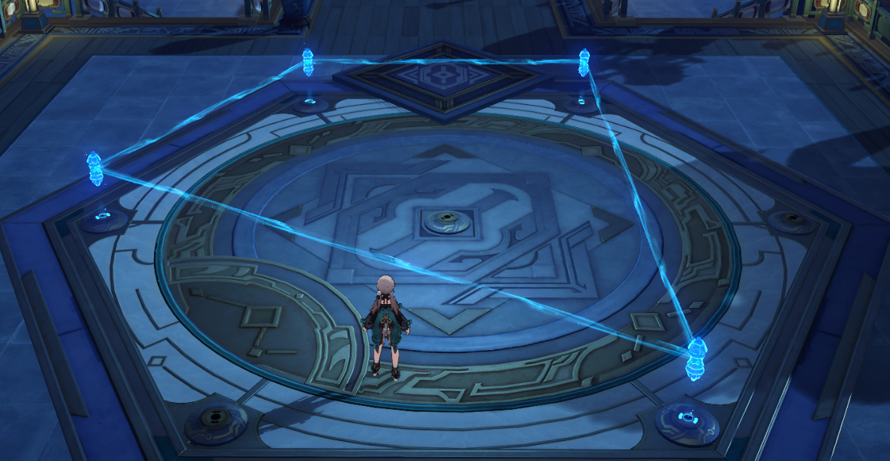
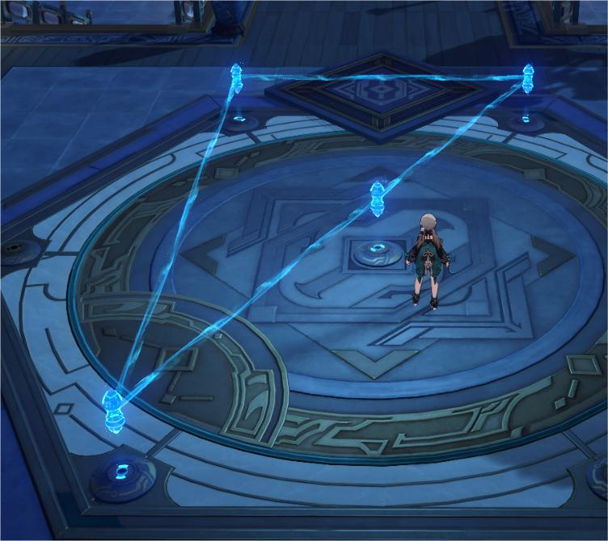

## 题目描述

时间限制：1.0 秒；内存限制：256 MB。

我们的命运被不确定性所笼罩。 全知者看穿了你…… 世间万物皆有其法则…… 然而，策略、星象……皆是人类的创造！ 圣徒胶鲶的门徒们正在欺诈和压迫平民。他们掠夺并破坏了许多珍贵的作品，践踏了人们的心血。 然而，太卜司的矩阵已经停止运作，符号变得暗淡，而圣徒胶鲶的门徒们尚未被消灭。符玄想要修复太卜司的矩阵，但她手头没有可用的力量。她需要你的帮助来重启太卜司的基座终端，并在此过程中消灭圣徒胶鲶的孽物。

每个基座终端都可以看作是一个棋盘。第 $n$ 个基座终端包含 $n$ 个布局。为了激活基座终端，你需要移动地面上的布局并连接其中的一些对，使得图案满足以下条件：

-   每个布局的坐标均为整数，且没有两个布局处于相同的位置；
-   布局与连接构成的图是一个简单图；
-   每条连接线都是一条线段。且没有两条连接线在内部相交。也就是说，任意两条连接线只能在端点（布局）处相交；
-   度数小于 6 的布局不超过 4 个。

现在，给定 $n$，请为第 $n$ 个基座终端找到一个解。（如果有多个解，输出其中任意一个。如果无解，请报告。）

简单图是指满足以下条件的无向图： _不是多重图，即每对顶点之间最多只有一条边；_ 不是环图，即没有自环，即没有起点和终点相同的边。

## 输入格式

$n$

## 数据范围

-   $1 \le n \le 100$

## 输出格式

如果无解，请输出一行 “No”。否则，请先输出一行 “Yes”，然后按以下格式输出你的排列：

$x_1 \ y_1$ $x_2 \ y_2$ $\vdots$ $x_n \ y_n$ $m$ $u_1 \ v_1$ $u_2 \ v_2$ $\vdots$ $u_m \ v_m$

其中 $x_i, y_i$ ($|x_i|, |y_i| \le 10^9$) 表示第 $i$ 个布局的坐标，$m$ 表示你连接的布局对的数量。$u_i, v_i$ ($1 \le u_i, v_i \le n$) 表示第 $u_i$ 个布局和第 $v_i$ 个布局之间存在连接。

你输出的所有数字都应为整数。

## 样例

### 输入格式 1

```text
3
```

### 输出格式 1

```text
Yes
-1 0
0 1
1 0
2
1 2
2 3
```

### 输入格式 2

```text
4
```

### 输出格式 2

```text
Yes
-998244353 -998244353
0 998244353
6 6
1 1
2
1 2
4 3
```

### 说明

更多示例，以下排列均为合法的：








但下面这个是不合法的，因为存在内部相交的连接：


