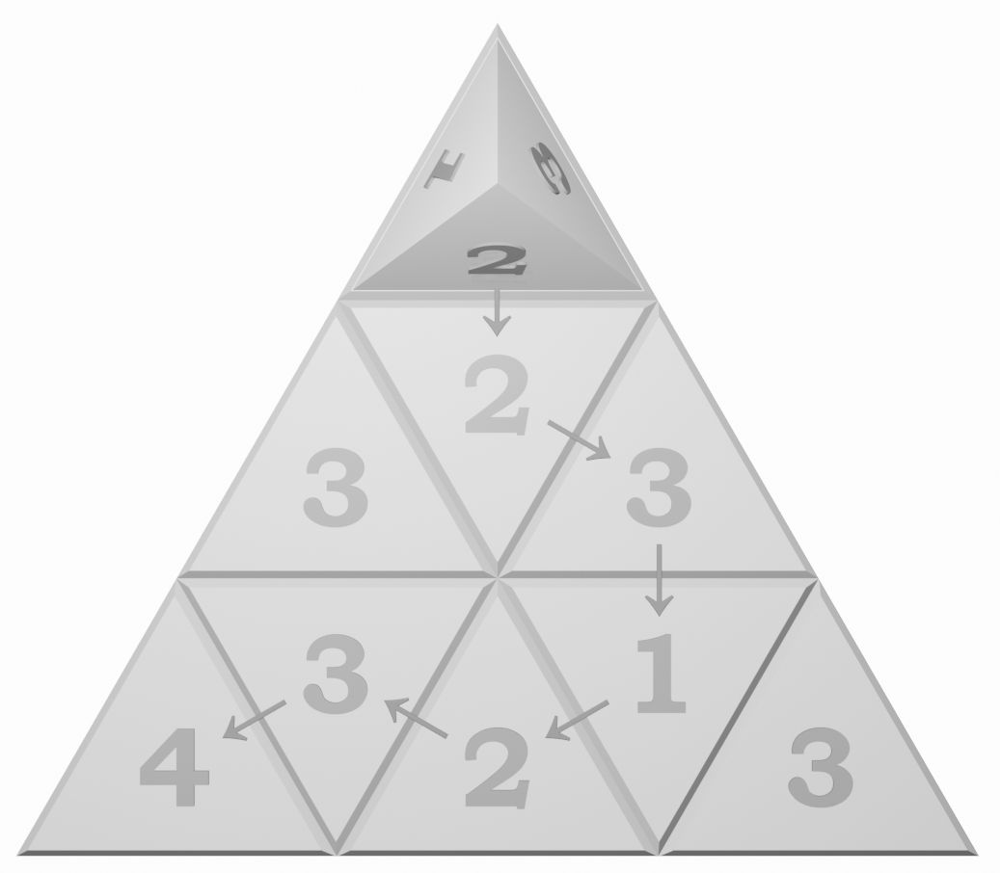

## 题目描述

时间限制：1.0 秒；内存限制：1024 MB。

Bobo 一直在玩一个名为 _Rolling Stones_ 的益智游戏，游戏在一个由 $n$ ($n \ge 2$) 行、$n^2$ 个单元格组成的等边三角形棋盘上进行。棋盘上的每个单元格都标有一个 1 到 4 之间的数字。Bobo 还有一个四面体形状的石头，每个面上分别标有 1 到 4 的数字（即一个四面体骰子），初始放置在棋盘第一行的第一个单元格上。石头的初始方位如下：标有 1 的面朝左，标有 2 的面朝向下一行，标有 3 的面朝右，标有 4 的面朝下。

该游戏的目标是在满足以下规则的前提下，将石头滚动到目标单元格：

-   **数字匹配**：当石头停在某个单元格上时，该单元格上的数字必须与石头底面上的数字相匹配。
-   **单次访问**：在整个过程中，每个单元格只能被访问一次，包括起始单元格和目标单元格。

石头通过沿着接触棋盘的边翻滚来移动到相邻的单元格。给定棋盘布局、目标单元格以及石头的初始方位，Bobo 想知道：是否可以按照规则到达目标单元格？如果可以，到达目标单元格所需的最少滚动次数是多少？

第一个样例的解法示意图如下：



示意图

## 输入格式

第一行包含一个整数 $n$ ($2 \le n \le 100$)，表示棋盘的大小。

接下来 $n$ 行，第 $i$ 行 ($1 \le i \le n$) 包含 $2i - 1$ 个数字 $a_{i,1}, a_{i,2}, \dots, a_{i,2i-1}$，其中 $1 \le a_{i,j} \le 4$ 表示第 $i$ 行从左往右第 $j$ 个单元格上的数字。保证 $a_{1,1} = 4$。

最后一行包含两个整数 $x, y$ ($2 \le x \le n, 1 \le y \le 2x-1$)。其中 $(x, y)$ 表示目标单元格，位于第 $x$ 行从左往右第 $y$ 个单元格。

## 输出格式

如果无法将石头滚动到目标单元格，则输出 $-1$。否则，输出将石头滚动到目标单元格所需的最少滚动次数。

## 样例

### 样例输入 1

```text
3
4
3 2 3
4 3 2 1 3
3 1
```

### 样例输出 1

```text
6
```

### 样例输入 2

```text
3
4
3 3 3
4 3 2 1 3
3 1
```

### 样例输出 2

```text
-1
```
