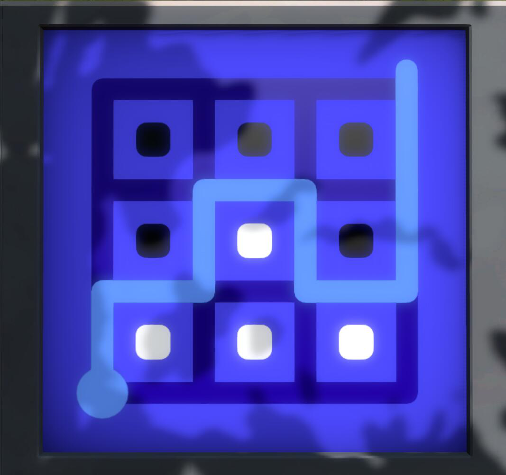

> QOJ 将此版本标注为 AI 翻译，可能存在不准确之处；有疑问时请核对原文。

## 题目描述

时间限制：1.0 秒；内存限制：1024 MB。

在闲暇时间，Bobo 很喜欢玩益智游戏。他最喜欢的是《见证者》（_The Witness_），这是一款由 Jonathan Blow 设计并于 2016 年发行的广受好评的益智电子游戏。《见证者》包含 9 种主要类型的谜题以及若干隐藏的“环境”谜题，游戏开放世界中总共有 664 个谜题。玩家需要探索世界并推导所遇到各种谜题的规则。

在所有类型的谜题中，Bobo 最擅长一种被称为“黑白方块”的谜题。这类谜题基于矩形网格，要求玩家在网格中连接起点和终点，画出一条简单的网格路径，同时将两种不同颜色的网格单元分开。以下是该类谜题在游戏中的一些真实示例及其解法。起点和终点分别用圆圈和从网格突出的半圆标记。

给定一个“黑白方块”谜题实例，其中所有单元格要么是黑色，要么是白色，Bobo 想给你出一个挑战：你能提供该谜题的解，或者断言它无解吗？

形式上，“黑白方块”谜题的实例描述如下：

-   两个正整数 $n, m$，表示矩形网格的行数和列数。网格中共有 $n \times m$ 个单元格和 $(n + 1) \times (m + 1)$ 个顶点。我们将网格左上角的顶点标记为 $(0, 0)$，右下角的顶点标记为 $(n, m)$，其余顶点依此类推。
-   一个 $n \times m$ 的二维数组，表示每个单元格的颜色。每个单元格的颜色只能是黑色或白色。
-   一个起点 $(sx, sy)$ 和一个终点 $(ex, ey)$，每个点都属于网格边界上的顶点。此处顶点 $(x, y)$ 在边界上意味着满足以下至少一个条件：
    -   $x = 0$
    -   $x = n$
    -   $y = 0$
    -   $y = m$

此外，起点和终点不能重合。

“黑白方块”谜题的解由一条路径 $P = ((x_1, y_1), (x_2, y_2), \dots, (x_\ell, y_\ell))$ ($\ell \ge 2$) 描述，满足以下性质：

-   $(x_1, y_1) = (sx, sy)$ 且 $(x_\ell, y_\ell) = (ex, ey)$。
-   对于每个 $2 \le i \le \ell$，$(x_{i-1}, y_{i-1})$ 和 $(x_i, y_i)$ 在网格上相邻，即满足以下条件之一：
    -   $x_i = x_{i-1}$ 且 $|y_i - y_{i-1}| = 1$
    -   $|x_i - x_{i-1}| = 1$ 且 $y_i = y_{i-1}$
-   $P$ 是简单路径，即对于每个 $1 \le i < j \le \ell$，要么 $x_i \neq x_j$，要么 $y_i \neq y_j$。
-   路径所分隔的网格的每个区域仅包含一种颜色。

## 输入格式

第一行包含两个整数 $n, m$ ($1 \le n, m \le 40$)。

接下来 $n$ 行，第 $i$ 行包含一个长度为 $m$ 的字符串 $s_i$，仅由字符 ‘B’ 和 ‘W’ 组成，其中 $s_i$ 的第 $j$ 个字符表示网格第 $i$ 行第 $j$ 列单元格的颜色。

随后一行包含四个整数 $sx, sy, ex, ey$ ($0 \le sx, ex \le n, 0 \le sy, ey \le m$)，表示起点和终点。保证起点和终点均在网格边界上且不重合。

## 输出格式

如果给定的“黑白方块”谜题实例无解，输出一行 “NO”（不含引号）。

否则，第一行输出 “YES”（不含引号）。然后输出一个整数 $\ell$ ($\ell \ge 2$)，表示解路径中包含的顶点数。接下来 $\ell$ 行，每行输出两个整数 $(x_i, y_i)$，表示解路径中的第 $i$ 个顶点。如果你的答案满足所需条件，则被视为正确。如果存在多个解，你可以输出其中任意一个。

你可以以任意大小写形式输出 “YES” 和 “NO”（例如，字符串 “yES”、“yes” 和 “Yes” 都将被识别为肯定回答）。

## 样例

### 样例输入 1

```text
3 3
BBB
BWB
WWW
3 0 0 3
```

### 样例输出 1

```text
YES
9
3 0
2 0
2 1
1 1
1 2
2 2
2 3
1 3
0 3
```

### 样例输入 2

```text
1 1
W
0 0 1 1
```

### 样例输出 2

```text
YES
3
0 0
1 0
1 1
```

### 样例输入 3

```text
2 2
WB
BW
0 0 2 2
```

### 样例输出 3

```text
NO
```

## 说明

第一个样例描述了题目中第五组图片里的“黑白方块”谜题实例。

对于第二个样例，另一个有效的解路径是 $P = ((0, 0), (0, 1), (1, 1))$。



Figure 1. 示例谜题 1

---

来源：[QOJ 中文题面](https://qoj.ac/problem/9775/statement/zh_cn)。保留 QOJ 提供的中文内容，仅转换为 Markdown 排版；原题及图示版权归原作者所有。
