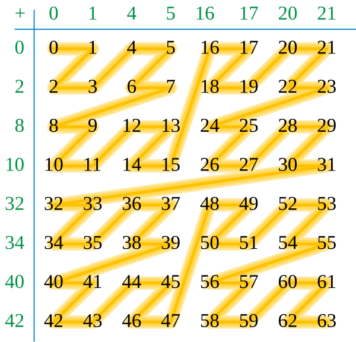
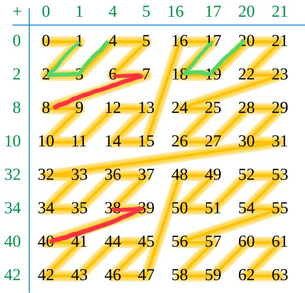

## 题目描述

时间限制：1.0 秒；内存限制：1024 MB。

欢迎来到中国大学生程序设计竞赛（CCPC）郑州站！Bobo 注意到“郑”和“州”的首字母都是 Z。这激发了他研究著名的 Z-order 曲线的兴趣。

为了介绍 Z-order 曲线，我们首先引入 Moser–de Bruijn 序列 $(B_t)_{t \ge 0}$，这是一个有序数列，其二进制表示中非零数字仅出现在偶数位上。Moser–de Bruijn 序列的前几项为 $0, 1, 4, 5, 16, 17, 20, 21$。

每个非负整数 $z$ 都可以唯一地分解为 $B_x$ 与 $2B_y$ 之和。因此，我们可以将所有自然数写在一个无限大的表格中。Z-order 曲线即通过按数值顺序连接所有数字而得到。



Z-curve 示意图

Bobo 现在向你提出以下问题：对于从 $L$ 到 $R$ 提取的 Z-curve 片段，求出最小的整数 $l$，使得从 $l$ 到 $l + R - L$ 的 Z-curve 与给定的片段相同（即从 $l$ 到 $l + R - L$ 的曲线可以通过平移从 $L$ 到 $R$ 的曲线得到）。

请注意，在本题中，曲线是有向的。具体来说，从 $1$ 到 $2$ 的曲线与从 $3$ 到 $4$ 的曲线**不**相同。

## 输入格式

输入的第一行包含一个整数 $T$ ($1 \le T \le 100$)，表示测试用例的数量。 每个测试用例仅一行，包含两个整数 $L$ 和 $R$ ($0 \le L < R \le 10^{18}$)。

## 输出格式

对于每个测试用例，输出一行答案。

## 样例

### 输入 1

```text
4
17 20
0 63
38 40
998244353998244353 998244853998244853
```

### 输出 1

```text
1
0
6
2145186925057
```

## 说明

下图展示了样例中第一个和第三个测试用例的 Z-curve。



样例测试用例示意图（红色：测试用例 1，绿色：测试用例 3）
