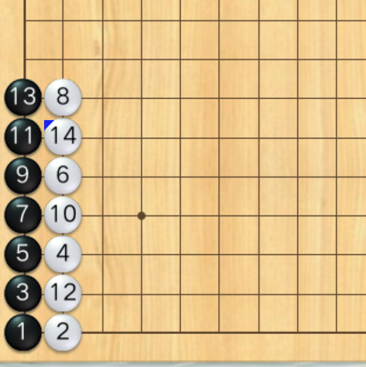

> QOJ 将此版本标注为 AI 翻译，可能存在不准确之处；有疑问时请核对原文。

## 题目描述

时间限制：1.0 秒；内存限制：256 MB。



传统的五子棋（Gomoku）是在一个较小的棋盘上进行的，当同一种颜色的五颗棋子连成一线时游戏立即结束。然而，在“新五子棋”（New Gomoku）中，规则有所不同。新五子棋的规则如下：

-   棋盘更大，长度和宽度均为 $1000$。
-   黑方和白方轮流落子，由黑方先手。已经落子的坐标不能重复落子。
-   如果恰好有 $5$ 颗同色棋子排成一条不间断的线（水平、垂直或与水平线呈 $45^\circ/135^\circ$ 的对角线），则称其为一组五子连珠。当某一方获得五子连珠时，游戏不会结束。
-   当达到预定的落子步数时，游戏结束。

你的任务是，在给定的 $n$ 步落子序列中，在每一步落子之后，输出刚刚落子的玩家所拥有的五子连珠的总数。

## 输入格式

单个输入文件中包含多组测试数据。输入的第一行包含一个整数 $T$（$1 \le T \le 10^4$），表示测试数据的组数。

对于每组测试数据：

-   第一行包含一个整数 $n$（$1 \le n \le 10^4$），表示落子的步数。
-   接下来的 $n$ 行，每行包含两个整数 $x_i, y_i$（$1 \le x_i, y_i \le 1000$），表示第 $i$ 步落子的坐标。保证同一组测试数据中的所有坐标都是互不相同的。

保证所有测试数据的 $n$ 之和不超过 $10^4$，即 $\sum n \le 10^4$。

## 输出格式

对于每组测试数据，输出一行，包含 $n$ 个整数，其中第 $i$ 个整数表示在第 $i$ 步落子之后，刚刚落子的玩家所拥有的五子连珠的总数。

## 样例

### 输入样例 1

```text
1
14
1 1
2 1
1 2
2 3
1 3
2 5
1 4
2 7
1 5
2 4
1 6
2 2
1 7
2 6
```

### 输出样例 1

```text
0 0 0 0 0 0 0 0 1 0 2 1 3 3
```

---

来源：[QOJ 中文题面](https://qoj.ac/problem/15419/statement/zh_cn)。保留 QOJ 提供的中文内容，仅转换为 Markdown 排版；原题及图示版权归原作者所有。
