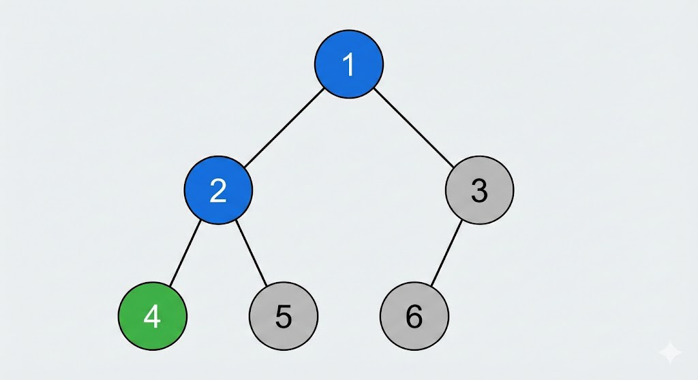

> QOJ 将此版本标注为 AI 翻译，可能存在不准确之处；有疑问时请核对原文。

## 题目描述

时间限制：1.0 秒；内存限制：256 MB。

一个公司由 $n$ 名成员组成，员工 ID 分别为 $1, 2, \dots, n$。成员 1 是老板，其他每个成员 $i$（$2 \le i \le n$）都有一个直接主管 $f_i$（$1 \le f_i < i$）。公司结构形成一棵以成员 1 为根的有根树。

在这家公司中，成员 $a$ **认识**成员 $b$ 当且仅当满足以下条件中的至少一条：

-   $a = b$。
-   $b$ 是 $a$ 的祖先。换句话说，存在一个序列 $u_1, u_2, \dots, u_k$（$2 \le k$）使得 $u_1 = a$，$u_k = b$，且对于所有 $2 \le i \le k$ 都有 $u_i = f_{u_{i-1}}$。
-   $b$ 是 $a$ 的直接孩子（$b$ 是 $a$ 的直接下属）。换句话说，$f_b = a$。

请注意，认识关系不一定是对称的；$a$ 认识 $b$ 并不意味着 $b$ 认识 $a$。

现在，成员们正在玩一个游戏。在每一轮中，一个特定的成员 $m$ 担任**猜测者**，另一个成员 $p$ 是**目标**。保证 $p$ 是一个 $m$ 不认识的成员。

为了确定 $p$ 的身份，$m$ 提出一系列问题。对于每个问题，$m$ 选择一个 ID $x$ 并询问：“$p$ 认识成员 $x$ 吗？”成员 $p$ 总是如实回答。此外，如果 $x = p$，$p$ 会特别透露自己就是成员 $x$，此时游戏结束。

每个问题都会根据公司树产生一定的移动代价。如果第 $i$ 个问题涉及成员 $x_i$，则该问题的代价为 $dis(x_{i-1}, x_i)$，其中 $dis(a, b)$ 是树上 $a$ 和 $b$ 之间唯一路径上的边数。对于第一个问题（$i = 1$），代价为 $dis(m, x_1)$。

成员 $m$ 非常聪明，他会使用最优策略，以最小化在最坏情况下保证游戏结束所需的总代价。你的任务是为每个可能的猜测者 $m \in \{1, 2, \dots, n\}$ 计算这个最小的最坏情况代价。

如果成员 $m$ 已经认识公司中的所有人，则该 $m$ 的答案为 0。

## 输入格式

输入的第一行包含一个整数 $n$（$1 \le n \le 10^5$），表示公司中的总成员数。

第二行包含 $n - 1$ 个整数，表示 $f_2, f_3, \dots, f_n$。满足 $1 \le f_i < i$。

## 输出格式

输出单行，包含 $n$ 个整数，表示 $m = 1, m = 2, \dots, m = n$ 时的答案。整数之间应以空格分隔。

## 样例

### 输入样例 1

```text
3
1 1
```

### 输出样例 1

```text
0 2 2
```

### 输入样例 2

```text
5
1 1 3 2
```

### 输出样例 2

```text
4 3 3 4 4
```

### 输入样例 3

```text
6
1 1 2 2 3
```

### 输出样例 3

```text
4 3 5 4 4 6
```

## 说明

为了解释样例 3 中 $m = 4$ 的情况：首先，如图所示，成员 $m$ 不认识成员 $\{3, 5, 6\}$。一种可能的最优策略是，首先询问 $p$ 是否认识成员 2，代价为 1。如果是，则表明 $p = 5$，下一步是询问成员 5 以结束游戏，总代价为 2。否则，继续询问 $p$ 是否认识成员 3，代价为 2。如果 $p = 3$，游戏结束，总代价为 3。否则，表明 $p = 6$，下一步花费 1 的代价询问成员 6，游戏结束，总代价为 4。因此，该策略在最坏情况下的代价为 4。可以证明，没有其他策略可以进一步降低最坏情况下的询问代价。


