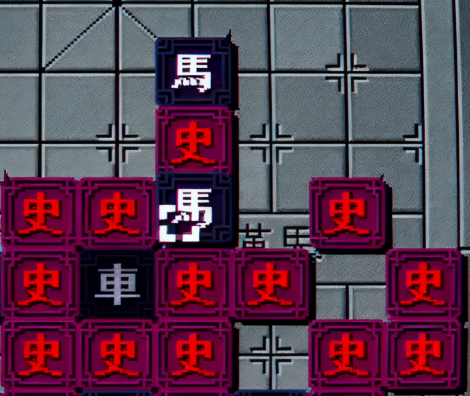

> QOJ 将此版本标注为 AI 翻译，可能存在不准确之处；有疑问时请核对原文。

## 题目描述

时间限制：1.0 秒；内存限制：256 MB。



在一个 $10$ 行 $9$ 列的棋盘上，正在进行一局名为“奇门象棋”的游戏。双方各有若干棋子，不同的棋子具有不同的特点。我们使用坐标 $(x, y)$ 表示棋盘上第 $x$ 行第 $y$ 列的位置。

我方拥有若干个“車”（Rook）和若干个“馬”（Knight），以及技能“移形换位”（Shape-shifting）。这两种棋子的移动方式以及该技能的描述如下：

-   假设“車”位于坐标 $(a, b)$。如果它在一步操作中移动到棋盘上的坐标 $(c, d)$，必须满足以下条件：
    -   $(c, d)$ 处没有我方棋子。即它不能吃掉我方棋子，也不能与我方棋子重叠。
    -   $c = a$ 或 $d = b$，且 $(a, b) \neq (c, d)$。即它可以沿其所在的行或列移动，但不能停留在原地。
    -   $(a, b)$ 和 $(c, d)$ 之间不能有任何其他棋子。即它在移动时不能越过其他棋子。
-   假设“馬”位于坐标 $(a, b)$。如果它在一步操作中移动到棋盘上的坐标 $(c, d)$，必须满足以下条件：
    -   $(c, d)$ 处没有我方棋子。即它不能吃掉我方棋子，也不能与我方棋子重叠。
    -   $\{|a - c|, |b - d|\} = \{1, 2\}$。这里 $\{...\}$ 表示无序集合。这对应于传统象棋中“日”字形（或“L”形）的移动（注意，本题中没有“蹩马脚”的规则）。
-   移形换位：这可以作为一步操作，用来交换任意两个我方棋子的位置。使用次数没有限制。

敌方拥有若干个“史莱姆”（Slime）。史莱姆无法移动，但具有以下特点：

-   假设“史莱姆”位于坐标 $(a, b)$。当它被吃掉并移出棋盘时，它会立即分裂，在相邻的四个位置（上、下、左、右）各生成一个“史莱姆”。具体来说，在这四个相邻位置中，如果某个位置已经存在任何其他棋子或超出了棋盘边界，则该位置不会生成新的史莱姆。
-   分裂生成的“史莱姆”具有相同的分裂特性，且分裂次数没有限制。

棋子移动后，如果与敌方棋子重叠，则会触发吃子，将敌方棋子移出棋盘。游戏的获胜条件是吃掉所有敌方“史莱姆”，确保棋盘上没有留下任何敌方棋子。

在玩游戏时，小标发现虽然敌方无法移动他们的棋子，但我方仍然很难干净地消灭所有史莱姆，因为它们数量众多且分裂效率极高，常常导致生成更多的史莱姆，这让小标很难判断这局游戏是否能够获胜。他找到了擅长策略和分析的你，希望你能帮他判断是否存在一种在 $10^4$ 步内获得胜利的策略。如果存在这样的获胜策略，请输出每一步的操作。

## 输入格式

输入包含 $10$ 行，每行包含一个长度为 $9$ 的字符串，表示棋盘的局势。 其中字符 `.` 表示空位置；字符 `C` 表示我方的“車”；字符 `M` 表示我方的“馬”；字符 `S` 表示敌方的“史莱姆”。

每种字符可能会出现多次。数据保证棋盘上至少有一个“史莱姆”且至少有一个我方棋子。

## 输出格式

如果不存在在 $10^4$ 步内获胜的策略：

-   请单行输出字符串 `WuJie`。

如果存在在 $10^4$ 步内获胜的策略：

-   首先，单行输出字符串 `YouJie`。
-   接着，输出一个整数 $s$，表示操作的步数。
-   然后输出 $s$ 行，每行包含四个整数 $a, b, c, d$，表示将当前位于 $(a, b)$ 的我方棋子移动到位置 $(c, d)$。特别地，如果 $(a, b)$ 和 $(c, d)$ 处都已经有我方棋子，则该操作被视为“移形换位”，表示这两个棋子交换位置。
-   你的策略必须确保在所有操作完成后，棋盘上没有残留的“史莱姆”。

如果存在多种不同的可行解，输出其中任意一种即可。

不符合格式要求、不符合棋子移动规则、或指定位置 $(a, b)$ 处没有我方棋子的解将被视为错误。

## 样例

### 输入样例 1

```text
...CSC...
...CCCM..
.........
.........
.........
.........
.........
.........
.........
.........
```

### 输出样例 1

```text
YouJie
6
1 4 1 3
1 3 1 2
1 2 1 1
1 1 2 4
2 4 1 4
2 7 1 5
```

### 输入样例 2

```text
SSSSSSSSS
SSSSSSSSS
SSSSSSSSS
SSSSSSSSS
SSSSSSSSS
SSSSSSSSS
SSSSSSSSS
SSSSSSSSS
SSSSSSSSS
SSSSCSSSS
```

### 输出样例 2

```text
WuJie
```

## 说明

样例 1 的输出展示了多种可行操作，并最终吃掉了所有史莱姆。

-   第 1 到 3 步展示了位于 $(1, 4)$ 的“車”向左移动，选择每次移动一格，最终停在 $(1, 1)$。
-   第 4 步展示了“移形换位”操作，将位于 $(1, 1)$ 的“車”与位于 $(2, 4)$ 的“車”进行交换。
-   第 5 步展示了位于 $(2, 4)$ 的“車”向上移动到 $(1, 4)$。
-   最后一步展示了“馬”从 $(2, 7)$ 跳到 $(1, 5)$ 以吃掉唯一的“史莱姆”。由于在此之后，该“史莱姆”相邻的位置没有可用的空位置，因此它无法分裂。游戏获胜。
