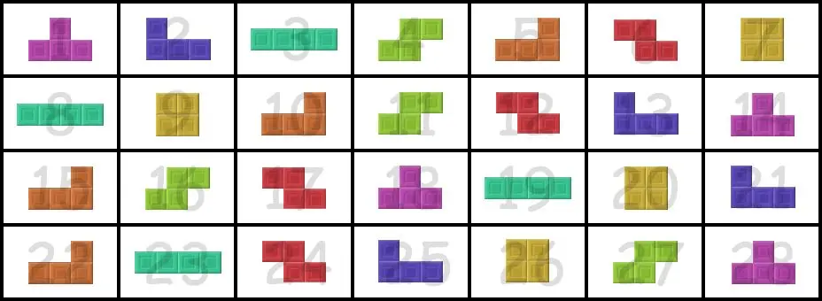

> QOJ 将此版本标注为 AI 翻译，可能存在不准确之处；有疑问时请核对原文。

## 题目描述

时间限制：3.0 秒；内存限制：512 MB。

小 C 对俄罗斯方块非常着迷。在经典的俄罗斯方块游戏中，有 7 种不同形状的方块，分别用字母 I、T、O、J、L、S 和 Z 表示。玩家每次会收到一个方块，并需要将其放置在特定位置。


然而，玩家收到的方块序列并不是完全随机的。相反，每 7 个不同的方块会被放入一个“袋子”（bag）中。在游戏开始时，玩家会依次收到第一个袋子中的所有方块，接着是第二个袋子中的所有方块，依此类推。每个袋子内部方块出现的顺序是完全随机的，且不同袋子之间的顺序是完全独立的。这种接收方块的方法被称为 **7-BAG** 机制。



在本题中，我们不局限于这 7 种不同的方块，而是考虑更一般的情况：存在 $n$ 种不同的方块，且接收方块的方法为 **$n$-BAG** 机制（即每 $n$ 个不同的方块被放入一个袋子中，每个袋子内部方块的接收顺序完全独立且随机）。每种方块被编号为 $1$ 到 $n$。我们面临以下问题：

从游戏开始到目前为止，小 C 已经收到了 $x$ 个方块。从小 C 收到的第 $(x + 1)$ 个方块开始，他开始记录自己收到的方块类型，一直记录到第 $(x + m)$ 个方块。因此，我们可以将这些方块的类型表示为 $f_1, f_2, \dots, f_m$。

由于小 C 不是记忆大师，他可能会忘记他记录的 $m$ 个方块中某些（甚至全部）方块的编号。他用 $0$ 来表示忘记的方块编号。

不幸的是，小 C 也忘记了 $x$ 的具体数值，但这个值对他未来的游戏规划非常重要。因此，小 C 希望你能根据他记住的信息，推断出哪些非负整数 $x$ 是可能满足条件的。

由于可能满足条件的 $x$ 有无穷多个，小 C 只对 $x \bmod n$ 的可能取值感兴趣。为了减少输出量，你只需要输出所有满足已知条件的 $x \bmod n$ 的可能取值的**数量**，以及它们的**按位异或和**。

由于小 C 不是记忆大师，他无法保证自己没有记错那些未遗忘的方块类型。在这种情况下，可能会产生矛盾，导致不存在任何满足已知条件的 $x$。此时，只需输出两个 `0` 来表示答案。

小 C 还会对他的记忆信息进行 $q$ 次修改。具体来说，他会修改他记住的第 $(x + a)$ 个方块的编号，将其从 $f_a$ 改为 $b$（特别地，若 $b = 0$，表示小 C 暂时忘记了第 $(x + a)$ 个方块的类型）。每次修改后，你都需要输出满足已知条件的 $x \bmod n$ 的可能取值的数量以及它们的按位异或和。

注意：每次修改都不是独立的，其影响会持续到后续的步骤中。

## 输入格式

第一行包含三个整数 $n, m, q$（$1 \le n \le 10^{18}$，$1 \le m \le 5 \times 10^5$，$0 \le q \le 5 \times 10^5$）。

第二行包含 $m$ 个整数，其中第 $i$ 个整数 $f_i$（$0 \le f_i \le n$）表示小 C 记住的第 $(x + i)$ 个方块的类型。特别地，若 $f_i = 0$，表示小 C 忘记了第 $(x + i)$ 个方块的类型。

接下来的 $q$ 行，每行包含两个整数 $a, b$（$1 \le a \le m$，$0 \le b \le n$），表示将小 C 记住的第 $(x + a)$ 个方块的类型修改为 $b$。特别地，若 $b = 0$，表示小 C 暂时忘记了第 $(x + a)$ 个方块的类型。

## 输出格式

输出共 $q + 1$ 行。第 $i$ 行应包含两个整数，表示在进行前 $i - 1$ 次修改后，满足已知条件的所有 $x \bmod n$ 的可能取值的**数量**以及它们的**按位异或和**。

## 样例

### 输入样例 1

```text
3 17 0
1 0 0 3 0 1 0 1 2 0 2 0 1 1 0 0 1
```

### 输出样例 1

```text
1 2
```

### 输入样例 2

```text
4 10 4
0 4 0 0 1 0 0 3 1 0
5 0
5 3
10 4
9 3
```

### 输出样例 2

```text
4 0
4 0
3 0
3 0
0 0
```

### 输入样例 3

```text
999999999999999999 10 10
0 0 0 0 314 15 0 0 9 0
1 0
9 287665588162745942
10 0
8 953846340212508779
10 275685051906270282
10 0
5 288735940850628909
9 14189307401575225
2 0
1 0
```

### 输出样例 3

```text
999999999999999999 999999999999999999
999999999999999999 999999999999999999
999999999999999999 999999999999999999
999999999999999999 999999999999999999
999999999999999999 999999999999999999
999999999999999999 999999999999999999
999999999999999999 999999999999999999
999999999999999999 999999999999999999
999999999999999999 999999999999999999
999999999999999999 999999999999999999
999999999999999999 999999999999999999
```

## 说明

### 样例 1 说明

这个记忆序列最初可能来自以下俄罗斯方块序列： `[3,2,1],[3,2,1],[2,1,3],[2,1,3],[1,2,3],[2,3,1],[1,2,3],[1,2,3],[1,2,3],[2,1,3]`。（括号表示袋子的划分，小 C 记住的信息是其中一部分。）

在这种情况下，$x = 5$。当然，对于 $x = 2, 8, 11, \dots$ 也是合法的。但当 $x \bmod 3 \ne 2$ 时，不存在合法的方案。因此，满足条件的 $x \bmod 3$ 的唯一可能取值集合为 $\{2\}$，其数量为 $1$，按位异或和为 $2$。

### 样例 2 说明

最初，满足条件的 $x \bmod n$ 的可能取值集合为 $\{0, 1, 2, 3\}$。

第一次修改将 $f_5$ 改为 $0$，记忆序列变为 `[0, 4, 0, 0, 0, 0, 0, 3, 1, 0]`，此时 $x \bmod n$ 的可能取值集合仍为 $\{0, 1, 2, 3\}$。

第二次修改后，满足条件的 $x \bmod n$ 的可能取值集合变为 $\{1, 2, 3\}$。

第三次修改后，满足条件的 $x \bmod n$ 的可能取值集合仍为 $\{1, 2, 3\}$。

### 样例 3 提示

注意：$n$ 可能会非常大。
