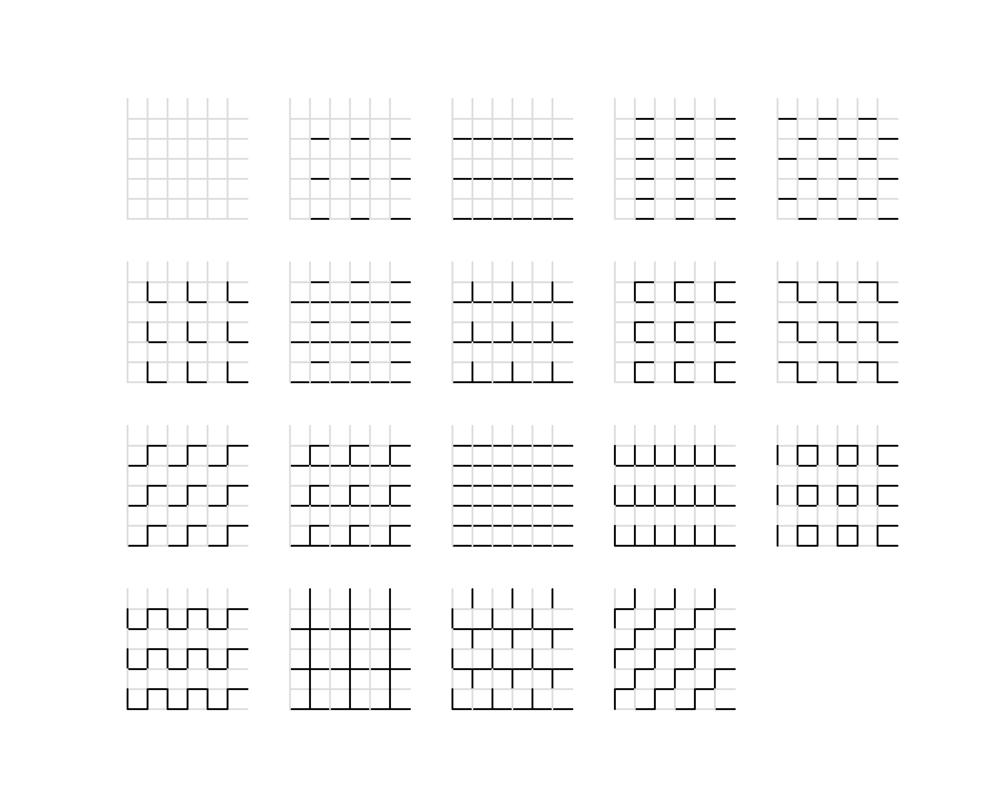

> QOJ 将此版本标注为 AI 翻译，可能存在不准确之处；有疑问时请核对原文。

## 题目描述

时间限制：1.0 秒；内存限制：256 MB。

在一个无限大的地板上，你需要铺设无限多的瓷砖。

每块瓷砖都有一个大小为 $n \times n$ 的正方形网格图案。瓷砖的每个网格单元的底边和左边都固定有一条 LED 灯带，它们有不同的颜色，从而创造出五彩斑斓的图案。

每块瓷砖上的图案完全相同。铺设瓷砖时，我们将无限多的瓷砖无缝地并排摆放，形成一个无限大的灯带图案。

有 $k$ 种不同的颜色可用，你需要为一块瓷砖上的总共 $2n^2$ 条灯带选择相应的颜色，之后其他瓷砖将自动复制这种着色方案。铺设瓷砖时，所有瓷砖都将以相同的方向铺设，这意味着它们可以被视为直接平移单块瓷砖然后拼接在一起，而不进行旋转。

当你在地板上行走时，你想知道有多少种本质不同的瓷砖着色方案。由于地板是无限大的，且一个人在观察瓷砖时可能会面对不同的方向（东、南、西、北），因此两种方案被定义为本质相同，当且仅当：

在观察由这两种方案创建的无限地板平面时，如果存在一系列平移或旋转（不包括翻转）能够使地板上所有位置的灯带颜色完全相同，则这两种方案被视为本质相同。

## 输入格式

输入包含单个测试文件中的多个测试用例。输入的第一行包含一个正整数 $T$ ($1 \le T \le 10$)，表示测试用例的数量。

对于每个测试用例：

-   输入的第一行包含两个整数 $n$ 和 $k$ ($1 \le n \le 10^9$，$1 \le k \le 10^9$)，分别表示图案的大小和颜色的数量。

## 输出格式

对于每个测试用例，输出单行，包含一个整数，表示本质不同的方案数，模 $10^9 + 7$。

## 样例

### 输入样例 1

```text
3
1 2
2 2
114514 5201314
```

### 输出样例 1

```text
3
31
377726028
```

## 说明

以下图像显示了 $n = k = 2$ 时的 19 种构造方案（为了更好地说明铺砖效果，每张图像显示了以 $3 \times 3$ 模式排列的 9 块瓷砖，LED 有深色和浅色两种颜色）。通过交换前 12 种方案的深色和浅色，可以获得另外 12 种方案，从而总共得到 31 种方案。



---

来源：[QOJ 中文题面](https://qoj.ac/problem/15430/statement/zh_cn)。保留 QOJ 提供的中文内容，仅转换为 Markdown 排版；原题及图示版权归原作者所有。
