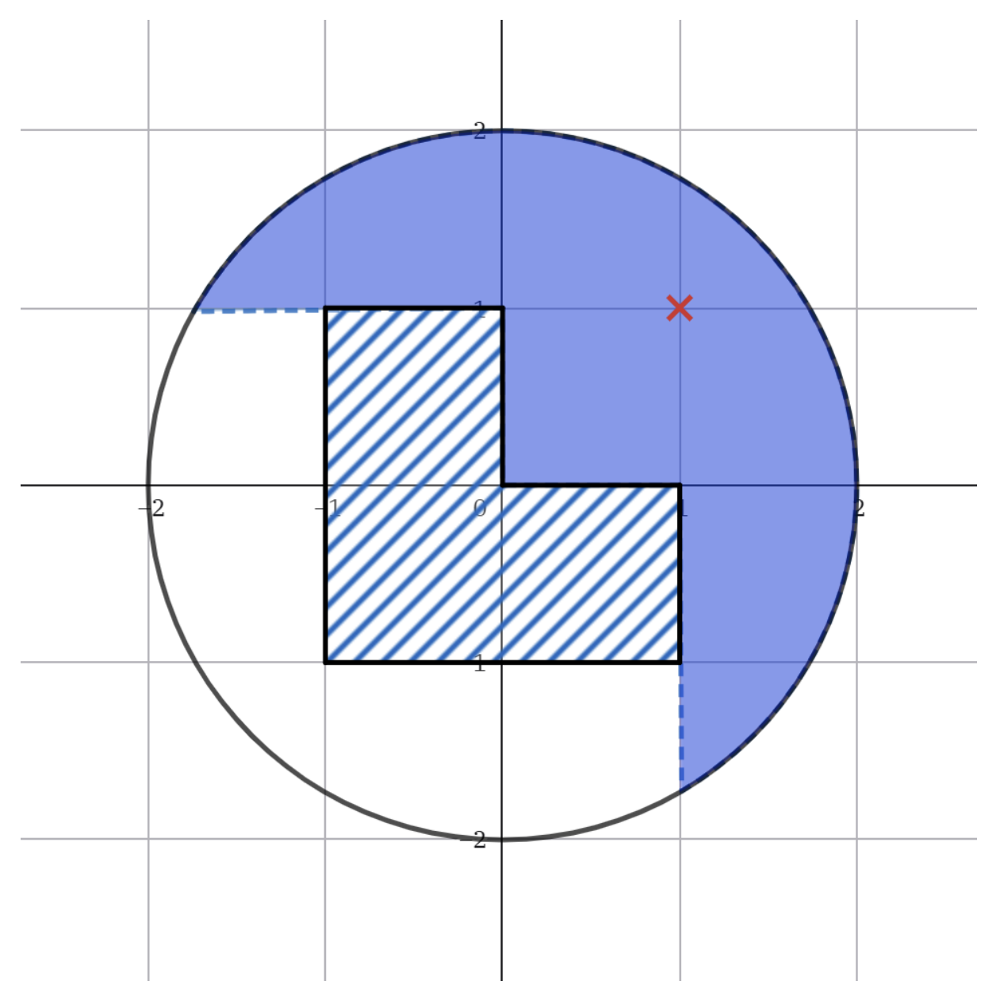
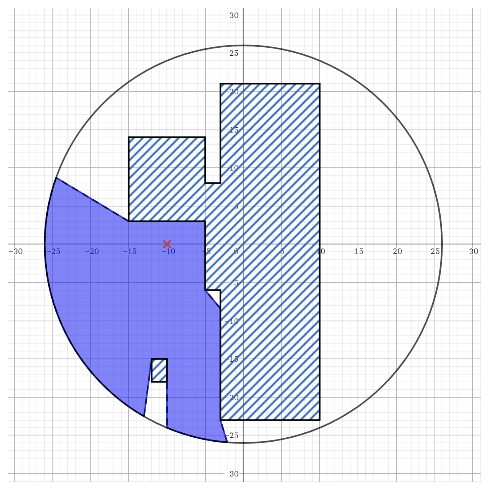

> QOJ 将此版本标注为 AI 翻译，可能存在不准确之处；有疑问时请核对原文。

## 题目描述

时间限制：6.0 秒；内存限制：1024 MB。

在一片遥远的土地上，有一座堡垒。如果我们用笛卡尔直角坐标系来表示方位，堡垒的领地可以看作是一个以原点为圆心、半径为 $R$ 的圆。堡垒领地的边界被高墙环绕，从堡垒内部是无法看到外面的。

堡垒内部有一些建筑物。为了方便起见，建筑物的边界由 $n$ 个可能重叠的矩形表示，这些矩形的边平行于坐标轴。如果堡垒内部的一个点严格位于任何一个矩形的内部，则该点被视为被遮挡（矩形边界上的点不被视为在内部）。

小 S 是这座堡垒的守卫。他站在堡垒内部某个未被遮挡的点 $(x, y)$ 处。小 S 能够守卫堡垒内部的另一个点 $(x', y')$，当且仅当线段 $(x, y) - (x', y')$ 上的每个点（包括两个端点）都未被遮挡。任务是计算小 S 能够守卫的点集的面积，这代表了小 S 可以监视的堡垒土地面积。

## 输入格式

本题包含多个测试用例。输入的第一行包含一个整数 $T$ ($1 \le T \le 10^5$)，表示测试用例的数量。

对于每个测试用例：

-   第一行包含两个整数 $R, n$ ($0 < R \le 10^6, 0 \le n \le 10^5$)，分别表示堡垒的半径和矩形的数量。
-   接下来的 $n$ 行，每行包含四个整数 $x_1, y_1, x_2, y_2$ ($|x_1|, |x_2|, |y_1|, |y_2| \le 10^6, x_1 < x_2, y_1 < y_2$)，描述一个矩形，其中 $(x_1, y_1)$ 表示左下角的坐标，$(x_2, y_2)$ 表示右上角的坐标。保证所有矩形都严格位于堡垒领地内部，且不与领地边界接触。
-   最后一行包含两个整数 $x, y$ ($|x|, |y| \le 10^6, x^2 + y^2 < R^2$)，表示小 S 的坐标。保证点 $(x, y)$ 未被遮挡。

保证所有测试用例中 $n$ 的总和不超过 $10^5$。

## 输出格式

对于每个测试用例，输出单行，包含一个实数，表示小 S 在堡垒内可以守卫的点集的面积。

如果与标准答案的相对或绝对误差小于 $10^{-6}$，则答案将被视为正确。换句话说，如果你的输出是 $a$，标准答案是 $b$，当且仅当 $\frac{|a-b|}{\max(1,b)} \le 10^{-6}$ 时，你的输出被认为是正确的。

## 样例

### 输入

```text
2
2 3
-1 -1 0 0
-1 -1 0 1
0 -1 1 0
1 1
26 5
-3 -23 10 21
-15 3 -5 14
-12 -18 -10 -15
-5 -6 -2 8
7 -23 10 -19
-10 0
```

### 输出

```text
5.598332050807308
513.142778328943998
```

## 说明

对于第一个测试用例，对应的示意图如下：



对于第二个测试用例，对应的示意图如下：



---

来源：[QOJ 中文题面](https://qoj.ac/problem/15033/statement/zh_cn)。保留 QOJ 提供的中文内容，仅转换为 Markdown 排版；原题及图示版权归原作者所有。
