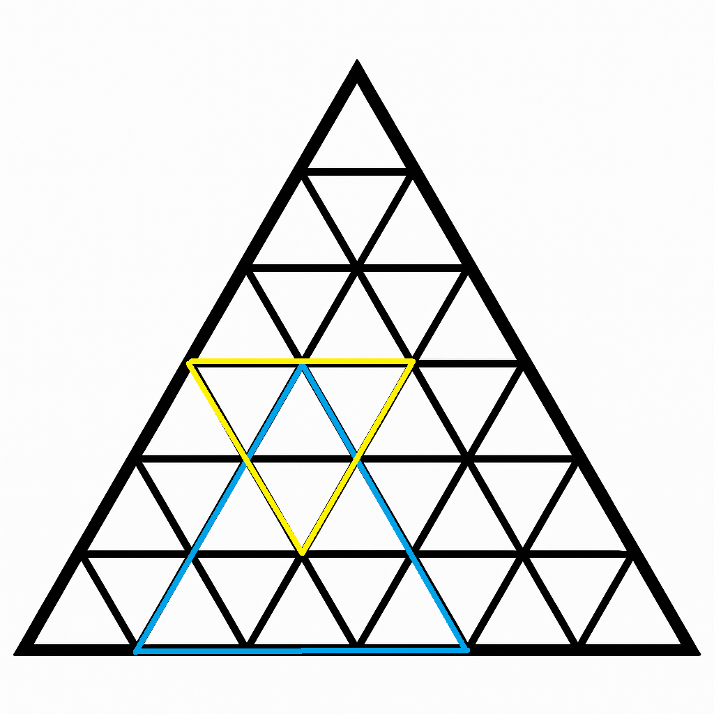

> QOJ 将此版本标注为 AI 翻译，可能存在不准确之处；有疑问时请核对原文。

## 题目描述

时间限制：4.0 秒；内存限制：1024 MB。

小 L 有一个正三角形网格，其中每条网格线都是连接相邻两边对应的 $n$ 等分点的线段。这些网格线将大正三角形分割成若干个全等的较小正三角形。

对于图中网格线的每个交点，我们用坐标 $(x, y)$ 来表示。从上到下的 $x$ 坐标范围为 $1$ 到 $n+1$。$x = 1$ 表示最顶部的点，而 $x = n+1$ 表示最底部的行。对于第 $i$ 行，从左到右的网格点的 $y$ 坐标范围为 $1$ 到 $i$。

在三角形网格中，有若干个正三角形，它们的方向可能是正向（朝上）或反向（朝下）。对于每种方向的三角形，我们用三个数 $x, y, d$ 来表示。其中，$(x, y)$ 表示其平行于网格底边的边所对的顶点的坐标，$d$ 表示其边长（线段长度）。

例如，在下图之中，蓝色正三角形是一个正向三角形，其 $(x, y, d) = (4, 2, 3)$。黄色正三角形是一个反向三角形，其 $(x, y, d) = (6, 3, 2)$。



现在，对于每个单位小正三角形网格（边长为 $1$ 的正三角形，无论方向如何），上面都写着一个数字。初始时，网格上的所有数字均为 $0$。小 L 将进行以下操作：

-   选择一个正三角形，将其中所有网格上的数字都加上 $w$。
-   选择一个正三角形，查询其中所有网格上的数字之和。

他希望你能计算出每次查询操作的答案。由于小 L 不喜欢大数，你只需要输出答案模 $2^{32}$ 的结果。

## 输入格式

第一行包含两个整数 $n, q$（$2 \le n \le 10^5, 1 \le q \le 10^5$）。

接下来的 $q$ 行，每行代表一次操作。

每行开头有五个数字 $opt, type, x, y, d$（$opt \in \{1, 2\}, type \in \{0, 1\}, 1 \le x \le n+1, 1 \le y \le x, 1 \le d \le n$）。

$opt$ 表示操作类型，其中 $opt = 1$ 为修改操作，$opt = 2$ 为查询操作。$type$ 表示该操作中三角形的类型，其中 $type = 0$ 表示正向三角形，$type = 1$ 表示反向三角形。$x, y, d$ 描述该三角形。如果 $opt = 1$，则还有一个额外的数字 $w$（$0 \le w < 2^{32}$），表示该修改操作中加上的数值。

保证所有输入的三角形面积均不为零，且都是完全包含在大三角形内部的合法三角形。

## 输出格式

对于每个 $opt = 2$ 的查询，在新的一行中输出一个整数，代表该区域内数字之和模 $2^{32}$ 的结果。

## 样例

### 输入样例 1

```text
5 5
1 0 3 3 2 2
1 1 6 4 2 3
2 0 1 1 5
2 0 3 2 3
2 1 5 3 2
```

### 输出样例 1

```text
20
11
3
```

### 输入样例 2

```text
10 10
1 0 1 1 5 2
1 1 3 2 1 6
1 1 6 4 2 1
2 0 10 3 1
2 1 5 2 1
2 1 6 4 2 1
1 0 7 7 1 7
1 1 9 3 1 3
1 0 9 5 2 4
2 0 6 1 2
```

### 输出样例 2

```text
0
2
12
0
```

---

来源：[QOJ 中文题面](https://qoj.ac/problem/15312/statement/zh_cn)。保留 QOJ 提供的中文内容，仅转换为 Markdown 排版；原题及图示版权归原作者所有。
