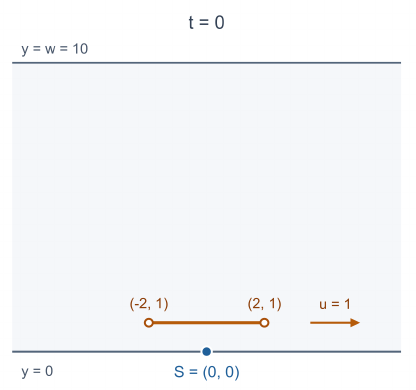

## 题目描述

时间限制：1 秒；内存限制：512 MB。

你正准备过马路，但一辆电动自行车正在路上疾驰。

在笛卡尔平面中，一条宽度为 $w$ 的道路沿 $x$ 方向无限延伸，占据带状区域 $0 \le y \le w$。你从固定点 $(0, 0)$ 出发，希望到达上边界 $y = w$ 上的任意一点，同时避开道路上的电动自行车。

电动自行车的车身用一条平行于 $x$ 轴的线段表示。在时刻 $t = 0$，它的两个端点为 $(x_1, y_c)$ 和 $(x_2, y_c)$，其中 $x_1 < x_2$。电动自行车以恒定的水平速度 $u$ 行驶，因此在时刻 $t$，它的两个端点为 $(x_1 + ut, y_c)$ 和 $(x_2 + ut, y_c)$。

你可以向任意方向移动，也可以等待，但你的速度始终不得超过 $v$。等价地，对于任意两个时刻 $0 \le t_1 \le t_2$，你在这两个时刻的位置之间的欧几里得距离至多为 $v(t_2 - t_1)$。在任何时刻，你都不得位于电动自行车的线段上，两个端点除外；允许接触任意一个端点。

你在时刻 $t = 0$ 从 $(0, 0)$ 出发。求安全到达 $y = w$ 上任意一点所需的最短时间。可以证明，答案总是存在。

## 输入格式

第一行包含一个整数 $T$（$1 \le T \le 2000$），表示测试用例的数量。

每个测试用例由一行组成，包含六个整数 $w, x_1, x_2, y_c, u, v$（$2 \le w \le 4 \times 10^4$，$-4 \times 10^4 \le x_1 < x_2 \le 4 \times 10^4$，$1 \le y_c \le w - 1$，$-4 \times 10^4 \le u \le 4 \times 10^4$，$1 \le v \le 4 \times 10^4$）。其中，$w$ 是道路的宽度，$(x_1, y_c)$ 和 $(x_2, y_c)$ 是电动自行车在时刻 $t = 0$ 的两个端点，$u$ 是电动自行车的水平速度，$v$ 是你的最大速度。

## 输出格式

对于每个测试用例，在单独一行输出一个实数：安全到达 $y = w$ 所需的最短时间。

如果你的答案的绝对误差或相对误差不超过 $10^{-6}$，则认为答案正确。更准确地说，对于你输出的每个值 $a$ 及其对应的参考值 $b$，必须满足 $\frac{|a-b|}{\max(1, |b|)} \le 10^{-6}$。

## 样例

### 输入格式 1

```text
3
10 100 110 5 3 1
10 -2 2 1 1 2
10 -2 2 1 -1 1
```

### 输出格式 1

```text
10.000000000
5.286299648
10.250000000
```

## 说明

下图展示了样例中第二个测试用例的初始状态（$t = 0$）。橙色线段表示电动自行车，蓝色点 $S = (0, 0)$ 是你的起点。箭头表示电动自行车的运动方向，其中 $u = 1$。


