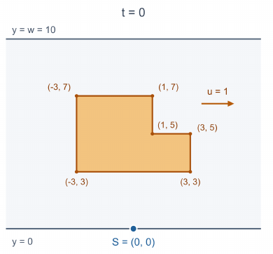

## 题目描述

时间限制：2 秒；内存限制：512 MB。

你正准备过马路，但有一辆汽车正在路上疾驰。

在笛卡尔平面中，一条宽度为 $w$ 的道路沿 $x$ 方向无限延伸，占据区域 $0\le y\le w$。你想从下边界 $y=0$ 穿过道路，到达上边界 $y=w$，同时避开路上的汽车。

汽车的车身由一个具有 $n$ 个顶点的简单多边形表示。在时刻 $t=0$，其顶点按沿边界逆时针的顺序依次为 $(x_1,y_1),(x_2,y_2),\ldots,(x_n,y_n)$。汽车以恒定的水平速度 $u$ 移动，因此在时刻 $t$，其第 $i$ 个顶点位于 $(x_i+ut,y_i)$。

你可以向任意方向移动或等待，但你的速度始终不能超过 $v$。等价地，对于任意两个时刻 $0\le t_1\le t_2$，你在这两个时刻所在位置之间的欧几里得距离至多为 $v(t_2-t_1)$。你在任何时刻都不能严格位于车身内部；允许接触其边界。

给定 $q$ 个相互独立的询问。在第 $j$ 个询问中，你在时刻 $t=0$ 从 $(s_j,0)$ 出发。求安全到达直线 $y=w$ 上任意一点所需的最短时间。对于每个询问，汽车都会在时刻 $t=0$ 从给定的同一个初始状态重新出发；各个询问互不影响。可以证明答案总是存在。

## 输入格式

第一行包含一个整数 $T$（$1\le T\le5\times10^4$），表示测试用例的数量。

每个测试用例的第一行包含四个整数 $n,w,u,v$（$3\le n\le5\times10^5$，$1\le w,v\le10^9$，$-10^9\le u\le10^9$），分别表示汽车的顶点数、道路的宽度、汽车的水平速度以及你的最大速度。

接下来的 $n$ 行描述汽车在时刻 $t=0$ 的状态。第 $i$ 行包含两个整数 $x_i,y_i$（$-10^9\le x_i\le10^9$，$0\le y_i\le w$），表示其第 $i$ 个顶点的坐标。顶点按沿边界逆时针的顺序给出，并构成一个简单多边形：不相邻的边没有公共点，相邻的边仅在其公共端点处相交，且任意三个连续顶点不共线。

接下来一行包含一个整数 $q$（$1\le q\le5\times10^5$），表示询问的数量。随后 $q$ 行中的每行包含一个整数 $s_j$（$-10^9\le s_j\le10^9$），指定第 $j$ 个询问的起点 $(s_j,0)$。

保证所有测试用例的 $n$ 之和以及 $q$ 之和均不超过 $5\times10^5$。

## 输出格式

对于每个询问，在单独一行输出一个实数：安全到达 $y=w$ 所需的最短时间。

如果你的答案的绝对误差或相对误差不超过 $10^{-6}$，则认为答案正确。更准确地，对于你输出的每个数值 $a$ 及其对应的参考值 $b$，要求 $\frac{|a-b|}{\max(1,|b|)}\le10^{-6}$。

## 样例

### 输入格式 1

```text
3
6 10 1 3
-3 3
3 3
3 5
1 5
1 7
-3 7
3
0
6
-6
4 20 5 1
-12 2
2 2
2 10
-2 10
2
0
-12
4 8 2 5
-5 0
5 0
5 8
-5 8
2
-3
3
```

### 输出格式 1

```text
3.504497942940
3.333333333333
3.333333333333
20.211324865405
20.000000000000
1.885714285714
2.412409788555
```

### 说明

下图展示了样例中第一个测试用例的第一个询问的初始状态（$t=0$）。橙色多边形表示汽车，蓝色点 $S=(0,0)$ 是你的起点。箭头表示汽车的运动方向，其中 $u=1$。


