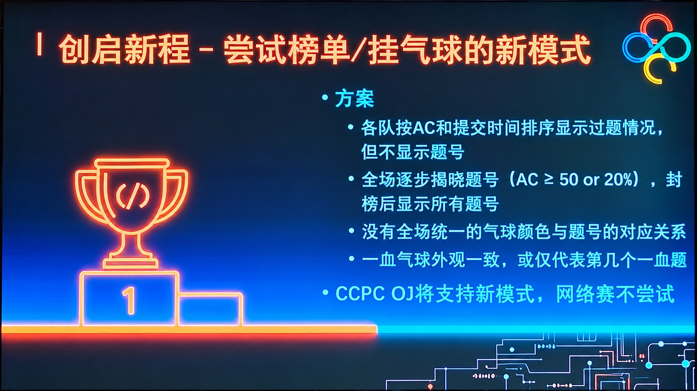

## 题目描述

时间限制：1 秒；内存限制：512 MB。

为了增强比赛的悬念和观赏性，CCPC 提出了一种采用“动态揭榜／发放气球”机制的新赛制。在这一赛制下，比赛过程中不会立即公开每支队伍具体通过了哪些题目，而是动态揭晓榜单信息。



根据规则，当以下任一条件成立时，某道题对应的榜单信息将“解冻”：

- 通过该题的队伍数大于等于 $50$。
- 通过该题的队伍数大于等于参赛队伍总数的 $20\%$，这一比例对应的人数不一定是整数。
- 比赛进入“封榜”时段。具体来说，时间以 `HH:MM` 格式表示从开赛起经过的时间；从第 $240$ 分钟起（含第 $240$ 分钟）进入封榜时段。

这一赛制尚未正式确定，本次网络赛也未采用。不过，为了提前熟悉接下来的现场赛规则，请你在本题中实现上述判定。

已知一场比赛共有 $n$ 支参赛队伍，其中 $m$ 支队伍通过了某道题，以及当前的比赛时间。请判断这道题目前是否满足解冻条件。

## 输入格式

第一行包含一个整数 $T$（$1\le T\le 100$），表示测试用例数。

接下来 $T$ 行，每行包含两个整数 $n,m$（$2\le n\le 10^4$，$0\le m\le n$）和一个格式为 `HH:MM` 的字符串，分别表示参赛队伍总数、当前通过这道题的队伍数，以及当前的比赛时间。保证时间在 `00:00` 到 `05:00` 之间，包含两个端点。

## 输出格式

对于每个测试用例，若满足解冻条件，输出 `YES`；否则输出 `NO`。

## 样例

### 输入

```text
5
100 50 00:00
100 10 03:59
100 10 04:00
100 20 02:00
10000 0 05:00
```

### 输出

```text
YES
NO
YES
YES
YES
```
