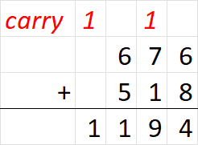

## 题目描述

时间限制：3 秒；内存限制：1024 MB。

给定一个正整数 $x$，求最小的正整数 $y$，使得 $x+y$ 的进位次数恰好为 $k$。

我们使用小学数学中学习的十进制列竖式加法来计算进位。例如，在下面的加法中，共有两次进位。



## 输入格式

第一行包含一个整数 $T$ ($1 \le T \le 10^5$)，表示测试用例的数量。

对于每个测试用例，第一行包含两个整数 $x, k$ ($1 \le x < 10^{18}, 0 \le k \le 18$)。

## 输出格式

对于每个测试用例，输出一行，表示答案。如果不存在这样的 $y$，则输出 $-1$。

## 样例

### 输入格式 1

```text
4
12345678 0
12345678 5
12345678 18
990099 5
```

### 输出格式 1

```text
1
54322
999999999987654322
9910
```
