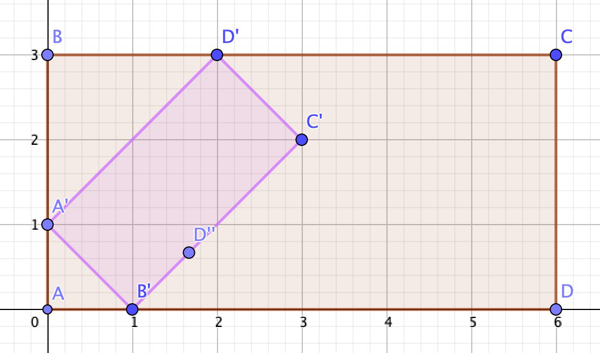

## 题目描述

时间限制：1 秒；内存限制：1024 MB。

有一个著名的数学事实：如果你将公园的地图完全放置在公园内部，那么地图上必然存在一个点，其位置与它所代表的公园中的点重合。

Mio 非常喜欢这个事实，于是她将一张她最喜欢的公园的地图完全放置在公园内。公园 $P$ 可以表示为一个矩形。地图只是公园的一个较小（或相等）的版本，印在纸上。地图与原始矩形相似。地图上的每个点通过相似变换对应公园中的一个点。

我们可以正式定义地图：地图是一个矩形 $M$（大小较小或相等），连同一个正实数 $r$ 以及一个双射函数 $f : M \to P$，满足： \* 对于任意一对不同的点 $a, b \in M$，满足 $|f(a) - f(b)| / |a - b| = r$。

$|x - y|$ 表示点 $x$ 和 $y$ 之间的欧几里得距离。

和许多游戏一样，Mio 可以利用地图进行传送。具体来说，当 Mio 位于地图上的某一点 $x$（包括边界）时，她可以传送至公园中对应的点 $f(x)$。她也可以选择不传送。反之亦然：当她位于公园中的某一点 $y$（包括边界）时，她可以传送至地图上代表她当前位置的点 $f^{-1}(y)$。她同样可以选择不传送。

Mio 最多可以传送 $n$ 次（最少 0 次）。每次传送需要 $k$ 秒。Mio 也可以以每秒 1 个单位的速度步行。

给定两个点 $s$ 和 $t$，求 Mio 从 $s$ 到达 $t$ 所需的最短时间。

每次传送可以是任意方向（从地图到公园，或从公园到地图）。地图可能被倒置放置。由于地图位于公园内部，Mio 有可能同时处于地图和公园中。在这种情况下，她可以选择向任意方向传送。

例如，在下图中，公园是 $ABCD$，地图是 $A'B'C'D'$。当 Mio 在地图内部时，她同时处于地图和公园中。当她位于点 $D'$ 时，她可以从地图传送到公园（到达 $D$），也可以从公园传送到地图（到达 $D$）。



例如，在下图中，公园是 ABCD，地图是 A'B'C'D'。当 Mio 在地图内部时，她同时处于地图和公园中。当她位于点 D' 时，她可以从地图传送到公园（到达 D），也可以从公园传送到地图（到达 D）。

## 输入格式

第一行包含一个整数 $T$ ($1 \le T \le 100$)，表示测试用例的数量。

对于每个测试用例，第一行包含表示公园的矩形的 4 个角。这些角按顺时针或逆时针顺序给出。保证这 4 个角互不相同。

第二行包含表示地图的矩形的 4 个角。地图的第 $i$ 个角对应公园的第 $i$ 个角，对于所有 $1 \le i \le 4$。注意，你可以通过角的顺序判断地图是否被倒置。这些角按顺时针或逆时针顺序给出。保证地图位于公园内部。（地图的边界可能在 1 个或多个点上与公园的边界相交。）保证地图是有效的，即存在一个正实数和一个从地图到公园的双射函数，满足上述定义。

第三行包含两个点 $s$ 和 $t$。保证 $s$ 和 $t$ 位于公园内部（或边界上）。

第四行包含两个整数 $k, n$ ($0 \le k \le 2 \times 10^6, 0 \le n \le 100$)，分别表示每次传送所需的时间和最大传送次数。

输入中的每个点均由一对整数表示，其绝对值不超过 $2 \times 10^6$。整数之间由单个空格分隔。

## 输出格式

对于每个测试用例，输出一行一个数字表示答案。如果你的答案的绝对误差或相对误差不超过 $10^{-9}$，则被视为正确。

## 样例

### 输入格式 1

```text
2
0 0 0 2 4 2 4 0
0 0 0 1 2 1 2 0
2 1 4 2
1 1
0 0 0 3 6 3 6 0
0 1 1 0 3 2 2 3
0 0 4 2
0 3
```

### 输出格式 1

```text
1.0000000000
1.2272623352
```
