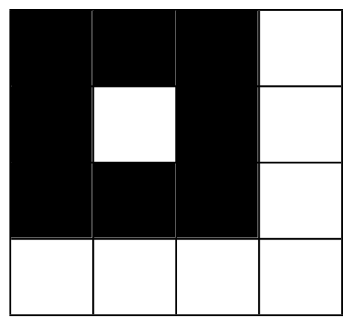

## 题目描述

时间限制：1 秒；内存限制：1024 MB。

Grammy 有一张 $n + 1$ 行 $m + 1$ 列的巨幅图片。行编号为 $1$ 到 $n + 1$，列编号为 $1$ 到 $m + 1$。

Grammy 决定以一种特殊的方式为这张图片上色。对于第 $i$ 行，Grammy 会以概率 $p_{i,j}$ 将该行最左侧的 $j$ ($1 \le j \le m$) 个单元格涂成黑色。对于第 $j$ 列，Grammy 会以概率 $q_{i,j}$ 将该列最顶部的 $i$ ($1 \le i \le n$) 个单元格涂成黑色。这些操作是相互独立的，且一个单元格可能被多次涂色。

我们将“美观度”定义为图片中相同颜色的极大正交连通区域的数量。在 Grammy 完成上色之前，她想知道图片中区域数量的期望值。请为她计算该图片的期望美观度。

两个单元格 $x$ 和 $y$ 处于同一个正交连通区域中，当且仅当它们满足以下条件： <em>它们颜色相同。</em> $x$ 与 $y$ 共享一条边，或者 $x$ 与某个单元格 $z$ 共享一条边，且 $y$ 与 $z$ 处于同一个正交连通区域中。

## 输入格式

第一行包含两个整数 $n, m$ ($1 \le n, m \le 1000$)，表示图片的大小。

接下来的 $n$ 行，每行包含 $m$ 个整数 $p_{i,j}$，表示将第 $i$ 行最左侧的 $j$ 个单元格涂黑的概率，模 $998\,244\,353$。保证每一行概率之和为 $1$。

接下来的 $n$ 行，每行包含 $m$ 个整数 $q_{i,j}$，表示将第 $j$ 列最顶部的 $i$ 个单元格涂黑的概率，模 $998\,244\,353$。保证每一列概率之和为 $1$。

## 输出格式

输出一个整数，表示图片期望美观度对 $998\,244\,353$ 取模的结果。

可以证明答案可以表示为不可约分数 $\frac{x}{y}$，其中 $x$ 和 $y$ 为整数且 $y \not\equiv 0 \pmod{998\,244\,353}$。输出等于 $x \cdot y^{-1} \pmod{998\,244\,353}$ 的整数。换句话说，输出一个整数 $a$，满足 $0 \le a < 998\,244\,353$ 且 $a \cdot y \equiv x \pmod{998\,244\,353}$。

## 样例

### 样例输入 1

```text
3 3
0 0 1
1 0 0
0 0 1
0 1 0
0 0 0
1 0 1
```

### 样例输出 1

```text
3
```

### 样例输入 2

```text
2 2
499122177 499122177
499122177 499122177
499122177 499122177
499122177 499122177
```

### 样例输出 2

```text
2
```

### 样例输入 3

```text
3 3
332748118 332748118 332748118
332748118 332748118 332748118
332748118 332748118 332748118
332748118 332748118 332748118
332748118 332748118 332748118
332748118 332748118 332748118
```

### 样例输出 3

```text
308100111
```

## 说明

第一个样例中只有一种可能的图片，如下图所示。图片中有 3 个极大正交连通区域，因此图片的美观度为 3。


