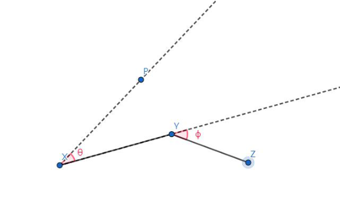

## 题目描述

时间限制：1 秒；内存限制：1024 MB。

Putata 最近迷上了玩 Zoe。此时，Putata 正在练习 Zoe 的技能“桨星”（paddle star）。

该技能允许 Zoe 发射一颗可以在飞行中改变方向的星星。星星造成的伤害与其飞行距离正相关。形式化地，假设 Zoe 当前位于点 $X$，并向任意方向发射。在任意时刻，Zoe 都可以改变星星的方向。如果星星位于点 $Y$，且新的方向指向某点 $Z$，则星星的轨迹为 $X \to Y \to Z$。如果星星在轨迹上遇到任何敌人，它会立即消失并对敌人造成伤害。

由于 Putata 对该技能的控制不够熟练，他发射的星星总是符合以下限制：第一段 $XY$ 的长度始终为 $\ell_1$，第二段 $YZ$ 的长度始终为 $\ell_2$。假设 Zoe 面向方向 $\vec{XP}$（这是一个确定的方向），令 $\langle \vec{XP}, \vec{XY} \rangle$ 为 $\theta$ 度，$\langle \vec{XY}, \vec{YZ} \rangle$ 为 $\phi$ 度，则 $\theta \in [-\alpha, \alpha]$ 且 $\phi \in [-\beta, \beta]$。你可以参考下图以帮助理解。



Putata 的对手 Budada 想知道 Putata 的 Zoe 可能攻击到的总面积。然而，Budada 正忙于数学题，所以他想请你帮他解决这个问题。

## 输入格式

第一行包含一个整数 $T$ ($1 \le T \le 10^5$)，表示测试用例的数量。

对于每个测试用例，输入为一行，包含四个整数 $\ell_1, \ell_2, \alpha$ 和 $\beta$ ($1 \le \ell_2 \le \ell_1 \le 10^9$, $0 \le \alpha \le 90$, $0 \le \beta < 180$)，表示该技能的属性。

## 输出格式

对于每个测试用例，输出一行，包含一个实数，表示答案。

如果你的答案与标准答案的绝对误差或相对误差不超过 $10^{-6}$，则被视为正确。形式化地，设你的答案为 $a$，标准答案为 $b$，若 $\frac{|a-b|}{\max(1,|b|)} \le 10^{-6}$，则你的答案被视为正确。

## 样例

### 输入 1

```text
5
2 1 20 20
3 3 0 0
20 20 90 120
20 10 50 170
100 10 1 93
```

### 输出 1

```text
3.490658503988659
0.000000000000000
3367.157611906510738
1098.863278984081717
373.960489570087645
```
