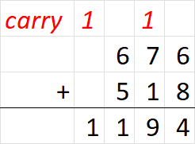

## 题目描述

时间限制：1 秒；内存限制：512 MB。

Prof. Pang 得到了 $n$ 个数字 $a_1, \dots, a_n$。使用计算机将这些数字相加非常容易，但 Prof. Pang 非常爱惜他的计算机，想要减轻它的工作负担。他决定手工模拟以下程序：

```text
Algorithm 3 Sum of elements
1: s ← 0
2: for i from 1 to n do
3: s ← s + a[i]
4: end for
```

与计算机不同，Prof. Pang 模拟该程序所需的时间与他在计算每个 $i$（从 $1$ 到 $n$）的 $s + a[i]$ 时产生的进位总数成正比。Prof. Pang 使用十进制列竖式加法来相加，就像我们在小学学的那样。例如，在下面的加法中，产生了两次进位：



请对数组 $a_1, \dots, a_n$ 进行重排，使得 Prof. Pang 在模拟程序时产生的进位总数尽可能小。（“重排数组”是指你可以任意改变元素的顺序。）

## 输入格式

第一行包含一个整数 $T$ ($1 \le T \le 10^5$)，表示测试用例的数量。

对于每个测试用例，第一行包含一个正整数 $n$ ($1 \le n \le 10^5$)。下一行包含 $n$ 个整数 $a_1, \dots, a_n$ ($1 \le a_i \le 10^9$)，表示 Prof. Pang 得到的数字。

保证所有测试用例的 $n$ 之和不超过 $10^5$。

## 输出格式

对于每个测试用例，输出一行，包含最少的进位次数。

## 样例

### 样例输入 1

```text
2
3
9 99 999
1
12345
```

### 样例输出 1

```text
5
0
```
