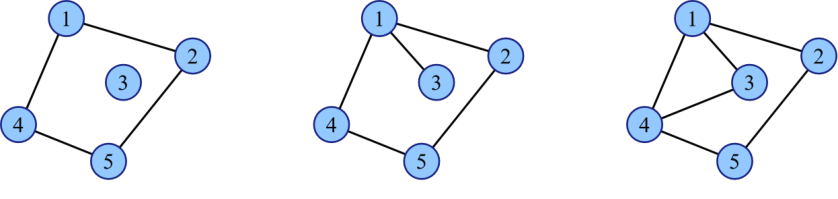

## 题目描述

时间限制：1 秒；内存限制：512 MB。

给定一个包含 $n$ 个顶点和 $m$ 条边的简单连通无向图，你可以添加任意数量（可能为零）的边，并计算使图变为双连通且保持为简单图的不同添加方式的数量，结果对 $998\,244\,353$ 取模。当且仅当存在一条边 $(u, v)$ 在一种添加方式中被添加，而在另一种方式中未被添加时，这两种添加方式被视为不同。

注意：

-   简单图不包含自环和重边。
-   对于连通图中的任意两个不同顶点，总存在至少一条从一个顶点到另一个顶点的路径。
-   对于双连通图中的任意两个不同顶点，总存在两条或多条不共享公共边的从一个顶点到另一个顶点的路径。



图：一个简单图、一个连通图和一个双连通图

如上所示，左侧的图是简单图但不是连通的，因为第 3 个顶点无法通过路径到达任何其他顶点；而中间的图是连通的但不是双连通的，因为无法找到从第 3 个顶点到任何其他顶点的两条不共享公共边的路径。

## 输入格式

第一行包含两个整数 $n$ ($2 \le n \le 5\,000$) 和 $m$ ($n-1 \le m \le \min(\frac{n(n-1)}{2}, 10\,000)$)，分别表示给定图的顶点数和边数。

接下来 $m$ 行，第 $i$ 行包含两个整数 $u$ 和 $v$ ($1 \le u, v \le n$)，表示第 $i$ 条边连接第 $u$ 个顶点和第 $v$ 个顶点。

## 输出格式

输出一行，包含一个整数，表示添加边的不同方式数量，对 $998\,244\,353$ 取模。

## 样例

### 输入格式 1

```text
3 2
1 2
2 3
```

### 输出格式 1

```text
1
```

### 输入格式 2

```text
4 4
1 2
2 3
3 4
4 1
```

### 输出格式 2

```text
4
```
