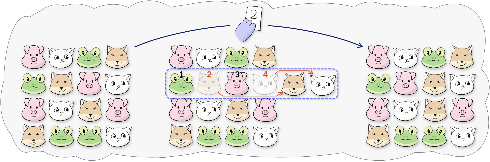

## 题目描述

时间限制：3 秒；内存限制：512 MB。

夜幕降临，霓虹闪烁，人群欢呼。随着月亮剧院的盛大演出开始，卡拉托尼亚（Calatonia）这座汇集了各种拟人化动物的城市，已准备好迎接一个不眠之夜。自复兴以来，这场年度演出从未因其包含的各种流派而未能点燃动物们对音乐的热情。所以这一次，它增加了更多吸引人的元素，比如舞蹈！

如果你在卡拉托尼亚询问任何生物关于最好的舞蹈团，他们很可能会回答：冰冷掠食者舞团（Icy Cold Predators Crew，简称 ICPC）。毫无疑问，它的表演将是今晚演出的亮点。你可能还会听到关于 Referee（嗯，这就是他的名字）是如何带领舞团走向巅峰的。作为导演，Referee 每天开始时都会选择背景音乐，并在下午忙于编舞。睡前，他倾向于制作一些华丽的服装，尽管这些服装在这样的世界里其实没什么用。虽然过程很累，但他却乐在其中。

Referee 自认为是一个天生的完美主义者。在队形设计上更是如此。在舞台下，他将整个舞团排列成一个 $n$ 行 $m$ 列的矩阵，行号从前到后依次为 $1, 2, \dots, n$，列号从左到右依次为 $1, 2, \dots, m$。每位舞者的物种可以用一个不超过 $3 \times 10^6$ 的正整数来标记，其中可能存在相同物种的动物。当且仅当两个排列中至少有一个位置的舞者物种不同时，这两个排列被视为不同。

由于对初始排列不满意，Referee 打算在不破坏矩阵队形的情况下重新排列舞团。他认为通过出示卡片来调整是一个好主意。当然不是红牌——毕竟 Referee 并不担任裁判。相反，他准备了分别写有 $1, 2, \dots, n$ 的白卡，以及分别写有 $1, 2, \dots, m$ 的黑卡，并指挥舞团执行以下操作：

-   当 Referee 出示写有 $k$ ($1 \le k \le n$) 的白卡时，第 $k$ 行的所有舞者从左到右报数，从 $1$ 到 $m$。报到偶数的人立即移动到该行的右端。最后，对齐以保持矩阵队形。
-   当 Referee 出示写有 $k$ ($1 \le k \le m$) 的黑卡时，第 $k$ 列的所有舞者从前到后报数，从 $1$ 到 $n$。报到偶数的人立即移动到该列的后端。最后，对齐以保持矩阵队形。



图：Referee 出示写有 2 的白卡

Referee 可以随心所欲地出示任意卡片任意次数（可能为零次），你的任务是计算他可能获得的不同排列的数量，由于结果可能非常大，请对 $998\,244\,353$ 取模。

## 输入格式

第一行包含一个整数 $T$ ($1 \le T \le 10^5$)，表示测试用例的数量。 对于每个测试用例： 第一行包含两个整数 $n$ 和 $m$ ($2 \le n, m \le 10^6$)，分别表示行数和列数。 接下来 $n$ 行，第 $i$ 行包含 $m$ 个整数 $a_{i,1}, a_{i,2}, \dots, a_{i,m}$ ($1 \le a_{i,j} \le 3 \times 10^6$)，其中 $a_{i,j}$ 表示初始时第 $i$ 行第 $j$ 列舞者的物种。 保证所有测试用例的 $n \times m$ 之和不超过 $3 \times 10^6$。

## 输出格式

对于每个测试用例，输出一行包含一个整数，表示不同排列的数量，对 $998\,244\,353$ 取模。

## 样例

### 输入 1

```text
2
4 4
1 2 3 4
3 4 1 2
1 2 4 1
4 3 3 2
3 9
1 8 1 1 8 1 1 8 1
1 8 8 8 8 8 8 8 1
1 1 1 8 8 8 1 1 1
```

### 输出 1

```text
96
6336
```
