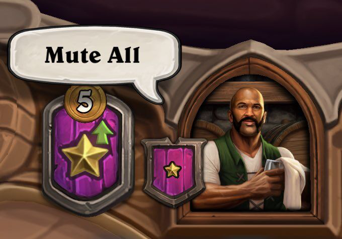

## 题目描述

时间限制：4 秒；内存限制：512 MB。

有一天，Alice 和 Bob 正在玩一款名为“酒馆战棋”（Tavern Chess）的在线棋牌游戏，每位玩家最多可以选择 7 个随从组成一个队伍。



欢迎来到酒馆

每个随从都有生命值（HP）和攻击力（ATK），初始时 HP 与 ATK 相等。生命值大于 0 的随从处于存活状态，可以进行攻击；如果随从在受到攻击后生命值降为 0 或更低，它会立即死亡。

战斗在 Alice 和 Bob 完成组队后开始，持续到其中一方的所有随从死亡，另一方获胜。如果双方最后存活的随从同时死亡，则战斗以平局告终。

Alice 和 Bob 的队伍轮流进行攻击，拥有更多随从的队伍先手。如果双方随从数量相同，则通过抛硬币决定——Alice 先手的概率为 50%，Bob 先手的概率为 50%。

当轮到某一方攻击时，该队伍中攻击次数最少且位置最靠左的随从会随机攻击对方队伍中存活的随从之一（等概率选择），随后轮到另一方进行攻击。

如果一个生命值为 $h_1$、攻击力为 $a_1$ 的随从攻击另一个生命值为 $h_2$、攻击力为 $a_2$ 的随从，每个随从都会对对方造成等同于自身攻击力的伤害。因此，攻击结束后，攻击方随从的生命值变为 $h_1 - a_2$，被攻击方随从的生命值变为 $h_2 - a_1$。

给定 Alice 和 Bob 的队伍，你需要分别计算 Alice 获胜、Bob 获胜以及平局的概率。

## 输入格式

第一行包含两个整数 $n$ 和 $m$ ($1 \le n, m \le 7$)，分别表示 Alice 和 Bob 队伍中随从的数量。

第二行包含 $n$ 个整数 $a_1, a_2, \dots, a_n$ ($1 \le a_i \le 10^9$)，其中第 $i$ 个数表示 Alice 队伍中从左往右第 $i$ 个随从的初始 HP 和 ATK。

第三行包含 $m$ 个整数 $b_1, b_2, \dots, b_m$ ($1 \le b_i \le 10^9$)，其中第 $i$ 个数表示 Bob 队伍中从左往右第 $i$ 个随从的初始 HP 和 ATK。

## 输出格式

输出三行，每行包含一个实数，分别表示 Alice 获胜、Bob 获胜以及平局的概率。

如果你的输出与标准答案的绝对误差不超过 $10^{-9}$，则被视为正确。即若你的输出为 $a$，标准答案为 $b$，当且仅当 $|a - b| \le 10^{-9}$ 时，你的输出被接受。

## 样例

### 样例输入 1

```text
2 3
2 5
3 4 1
```

### 样例输出 1

```text
0.125
0.75
0.125
```

### 样例输入 2

```text
6 6
1 1 4 5 1 4
1 1 4 5 1 4
```

### 样例输出 2

```text
0.241867283950617
0.241867283950617
0.516265432098765
```
