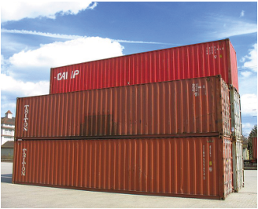

## 题目描述

时间限制：2 秒；内存限制：2048 MB。

宏伟的货船每天都在世界各地的海洋上航行，每艘船都载有数千个集装箱。它们的高效运作使得现代贸易成为可能，将货物运往世界各地所需的成本仅需几便士。



Cargo containers by Martini171 via Wikimedia Commons, cc by-sa

当船只到达目的地后，标准尺寸的集装箱会被从船上卸下，堆放在陆地上的堆场中，随后再由火车或卡车运往目的地。事实证明，移动集装箱的成本很高，因此港口运营商试图尽量减少运送货物所需的移动次数。

在本题中，我们考虑这样一个集装箱卸货场景。我们需要卸下 $n$ 个集装箱，并将它们放入两个从底向上堆叠的栈中。每个集装箱的放置位置是随机的，以相等的概率被放入第一个栈或第二个栈（与其他集装箱无关）。一旦所有集装箱卸载完毕，它们将按照给定的顺序被卡车取走。当卡车想要装载某个特定集装箱时，有两种情况：如果该集装箱位于其所在栈的顶部，则可以直接将其移至卡车，无需移动任何其他集装箱。否则，必须将集装箱从一个栈移动到另一个栈，直到所需的集装箱位于其所在栈的顶部。此时，该集装箱可以被移至卡车。

例如，考虑三个集装箱按 $1, 2, 3$ 的顺序到达的情况。假设 $1$ 和 $3$ 在第一个栈中，$2$ 在第二个栈中。如果集装箱按 $1, 2, 3$ 的顺序装上卡车，则需要进行五次移动：

| 栈 1 | 栈 2 | 说明 |
| --- | --- | --- |
| 1 3 | 2 | 初始配置（栈从底向上） |
| 1 | 2 3 | 将集装箱 3 从栈 1 移至栈 2 |
|  | 2 3 | 将集装箱 1 移至卡车 |
| 3 | 2 | 将集装箱 3 从栈 2 移至栈 1 |
| 3 |  | 将集装箱 2 移至卡车 |
|  |  | 将集装箱 3 移至卡车 |

表 Q.1：按 $1, 2, 3$ 顺序请求的集装箱移动示例。

我们想知道将所有集装箱交付给客户需要多少次移动。假设集装箱的放置是随机的，请计算给定卡车装载顺序下所需的期望移动次数。

## 输入格式

第一行包含一个整数 $n$ ($1 \le n \le 10^6$)，表示集装箱的数量。集装箱编号为 $1, 2, \dots, n$，并按此顺序从船上卸下。第二行包含 $n$ 个整数 $a_1, \dots, a_n$。这些数字是 $\{1, 2, \dots, n\}$ 的一个排列，指定了集装箱装上卡车的顺序。

## 输出格式

输出将集装箱装上卡车所需的期望移动次数——这不包括从船上卸下它们的成本，但包括在栈之间移动以及从栈移动到卡车的成本。你的答案的绝对误差应不超过 $10^{-3}$。

## 样例

### 输入格式 1

```text
5
4 2 5 3 1
```

### 输出格式 1

```text
7.000
```

### 输入格式 2

```text
6
1 2 3 4 5 6
```

### 输出格式 2

```text
13.500
```
