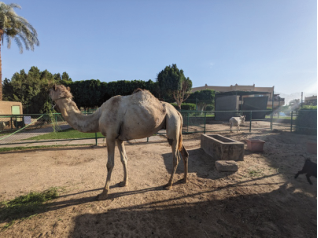

## 题目描述

时间限制：5 秒；内存限制：2048 MB。

在管理动物园时，你有时需要将动物在各个围栏之间移动。你可能会发现斑马会喜欢企鹅目前占据的更宽敞的围栏，而企鹅可能想搬到考拉目前居住的更冷的围栏；考拉则会搬到一个可以填满桉树的空围栏。因此，你会先移动考拉以腾出较冷的围栏，然后将企鹅移到那里，最后移动斑马。

你移动动物的方式是使用连接围栏的特殊隧道——你不想让动物移动到外面，既是因为它们可能会受到惊吓，也是因为它们可能会跑掉并伤害自己。



动物园里的一只骆驼、一头驴和（部分）一只山羊。

不幸的是，你最近又购入了一些动物，现在所有的围栏都满了，这使得移动动物变得更加困难。例如，假设考拉要搬到原来的斑马围栏——你不能先移动任何一组动物。相反，你学会的方法是同时移动动物——斑马、考拉和企鹅同时开始沿着不同的隧道移动，并同时到达它们的新围栏——因此它们永远不会相遇。注意，你不能通过这种方式直接交换两个相连围栏中的动物（因为它们会在隧道中相遇并受到惊吓）。

现在，你面临一个难题。你有一系列围栏，每个围栏里都有某种类型的动物；其中一些围栏通过隧道相连。你可以进行任意次数的操作，每次选择一组动物，并将每只动物移动到通过隧道相邻的围栏中，前提是该围栏中的动物也作为同一次移动的一部分被移走，且在同一次移动中，每条隧道最多只能使用一次。你也有关于如何放置动物的完美愿景。请问，是否可以通过一系列移动来实现这一目标？

## 输入格式

第一行包含两个整数 $n$ ($1 \le n \le 4 \cdot 10^5$) 和 $m$ ($0 \le m \le 4 \cdot 10^5$)，分别表示围栏的数量和隧道的数量。接下来 $n$ 行，第 $i$ 行包含两个整数 $b_i$ ($1 \le b_i \le 10^6$) 和 $e_i$ ($1 \le e_i \le 10^6$)，分别表示初始时围栏 $i$ 中的动物类型，以及所有移动完成后你希望围栏 $i$ 中拥有的动物类型。你可以假设 $e_1, \dots, e_n$ 是 $b_1, \dots, b_n$ 的一个排列。

接下来 $m$ 行描述隧道。每行包含两个整数 $x$ 和 $y$ ($1 \le x < y \le n$)，表示围栏 $x$ 和 $y$ 由一条双向隧道连接。没有两个围栏之间由多于一条的隧道连接。

## 输出格式

如果可以通过移动动物使得每个围栏都包含期望的动物类型，输出 `possible`。否则，输出 `impossible`。

## 样例

### 输入格式 1

```text
3 3
1 4
4 7
7 1
1 2
2 3
1 3
```

### 输出格式 1

```text
possible
```

### 输入格式 2

```text
2 1
1 2
2 1
1 2
```

### 输出格式 2

```text
impossible
```

### 输入格式 3

```text
5 6
10 40
20 30
30 50
40 20
50 10
1 2
2 3
1 3
3 4
3 5
4 5
```

### 输出格式 3

```text
possible
```

### 输入格式 4

```text
4 4
10 10
10 20
20 10
20 20
1 2
2 3
3 4
1 4
```

### 输出格式 4

```text
impossible
```
