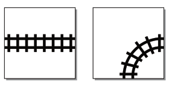
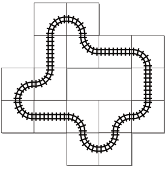

## 题目描述

时间限制：1 秒；内存限制：2048 MB。

每个小孩，甚至不少成年人，都对玩具火车着迷。从幼儿的“嘟嘟”小火车到发烧友填满整个地下室的精致模型铁路，这都是一门有利可图的生意。玩具火车轨道建筑公司（TTTCC）生产适用于各个年龄段和技术水平的火车轨道。为了让现有客户保持兴趣并吸引新客户，TTTCC 最近开始发布如何将他们的火车轨道连接成复杂布局的地图。通常，这始于设计师构思出一个有趣的轨道布局，然后发布该布局以及构建它所需的各种轨道段（例如，曲线和直线部分）的数量。但 TTTCC 最近了解到，许多客户正在寻求相反的服务：他们手头已经有一些现成的轨道段（可能是在祖母的阁楼里找到的），并希望利用它们来建造一条大型火车轨道。这会有多难呢？

为了研究自动化布局创建过程的可行性，TTTCC 有兴趣使用两种不同的形状来构建火车轨道：直线段和 90 度转弯（见图 U.1）。



图 U.1：直线轨道段和曲线轨道段。

有效的布局是通过将这些形状放置在方形网格上创建的，每个轨道件恰好占据一个网格单元。两种类型的轨道件都可以以 90 度为增量进行旋转。“规范的”火车轨道需要是连通的，并且应该形成一个单一的闭合回路。给定一组直线和曲线轨道段，可以构建的最长闭合回路是什么？



图 U.2：一个使用四个直线轨道段和十二个曲线段的轨道示例。这对应于样例输出 1。

## 输入格式

输入包含一行，包含两个整数 $s$ 和 $c$，分别表示可用的直线轨道段和曲线轨道段的数量（$0 \le s \le 10^5$，$4 \le c \le 10^5$）。

## 输出格式

输出一个使用最多 $s$ 个直线段和 $c$ 个曲线段的火车回路，该回路在满足此限制的情况下长度（以使用的轨道段数量计）最长。回路必须是闭合的且不能自交。如果存在多个最大长度的回路，则接受其中任何一个。

如果回路的长度为 $n$，则打印一个长度为 $n$ 的字符串，其中字符表示在单次遍历中遇到的回路段。字符 'S' 代表直线段，'L' 代表左转的曲线段，'R' 代表右转的曲线段。

## 样例

### 样例输入 1

```text
4 12
```

### 样例输出 1

```text
LSRLLRLSLSRLLSRL
```

### 样例输入 2

```text
1 5
```

### 样例输出 2

```text
LLLL
```
