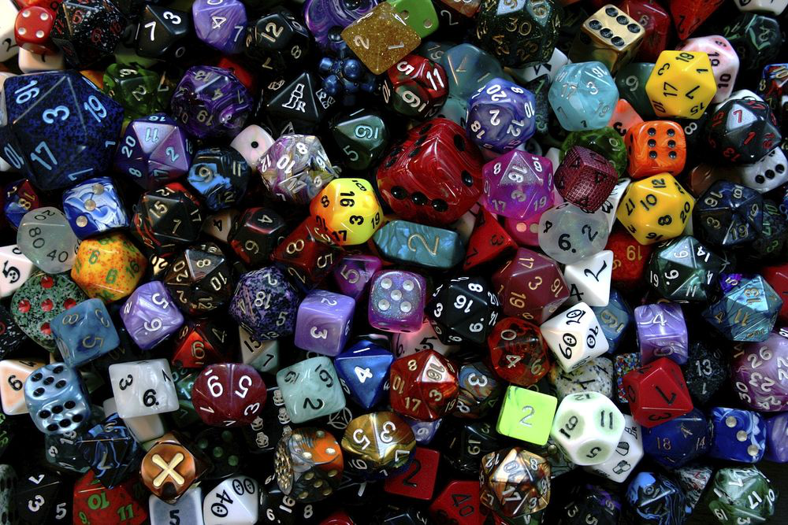

## 题目描述

时间限制：1 秒；内存限制：2048 MB。

看看它们是怎么滚动的！根据一个著名的故事，沃伦·巴菲特（Warren Buffett）曾经向比尔·盖茨（Bill Gates）发起了一场简单的掷骰子游戏挑战。他有三颗骰子；第一个玩家可以检查它们并从中选择一颗。第二个玩家随后从剩下的骰子中选择一颗，然后两名玩家掷出各自的骰子进行对决，目标是掷出更大的数字。沃伦提出让比尔先选，但这让比尔产生了怀疑，于是他选择后选。事实证明这是一个明智的选择：这些是传递性失效骰子（intransitive dice）。第一颗骰子在与第二颗对决时占优势，第二颗在与第三颗对决时占优势，但第一颗在与第三颗对决时却不占优势！



图片来自 rawpixel, CC0

为了形式化定义：将“骰子”定义为具有至少一个面的任何形状，使得每个面都显示一个正整数。当掷骰子时，其中一个面会被均匀随机地选中。当两颗骰子对决时，显示数字较大的一面所在的骰子获得 1 分；如果两个数字相等，则每颗骰子各获得 $\frac{1}{2}$ 分。对于骰子 $D$ 和 $D'$，定义 $score(D, D')$ 为 $D$ 在单次对决中从 $D'$ 处获得的期望得分。如果 $score(D, D') > \frac{1}{2}$，我们称 $D$ 对 $D'$ 占优势；如果 $score(D, D') = \frac{1}{2}$，则两颗骰子平局。例如，如果 $D$ 是样例输入中的第一颗骰子，$D'$ 是第二颗，则 $score(D, D') = \frac{4}{9}$ 且 $score(D', D) = \frac{5}{9}$，因此 $D'$ 对 $D$ 占优势。

给定两颗骰子 $D_1$ 和 $D_2$，使得 $D_1$ 对 $D_2$ 占优势，你想要找到第三颗骰子 $D_3$，使其与前两颗组成一个传递性失效的三元组。在所有对 $D_1$ 占优势或与 $D_1$ 平局的 $D_3$ 中，计算 $score(D_3, D_2)$ 的最小值。如果该值小于 $\frac{1}{2}$，你就可以组成一个传递性失效的三元组！类似地，在所有 $D_2$ 对其占优势或与之平局的 $D_3$ 中，计算 $score(D_3, D_1)$ 的最大值。

## 输入格式

输入包含两行，每行描述一颗骰子。其中一颗骰子（第一颗或第二颗）对另一颗占优势。占优势的骰子为 $D_1$，另一颗为 $D_2$。

每行的第一个整数给出 $n$ ($1 \le n \le 10^5$)，即骰子的面数。随后是 $n$ 个整数 $f_i$ ($1 \le f_i \le 10^9$，对于每个 $1 \le i \le n$)，给出了每个面上的整数。

## 输出格式

输出一行，包含在上述条件下 $score(D_3, D_2)$ 的最小值和 $score(D_3, D_1)$ 的最大值。这两个分数不需要使用相同的骰子 $D_3$。你的答案绝对误差应不超过 $10^{-6}$。

## 样例

### 样例输入 1

```text
6 1 1 6 6 8 8
3 2 4 9
```

### 样例输出 1

```text
0.291666667 0.750000000
```

### 样例输入 2

```text
4 9 3 7 5
3 4 2 3
```

### 样例输出 2

```text
0.500000000 0.500000000
```
