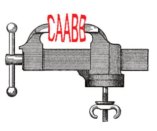

## 题目描述

时间限制：1 秒；内存限制：2048 MB。

无限压缩计划联盟（ICPC）开发了一种新的、出色的数据压缩策略，称为“不要重复自己”（DRY）。DRY 作用于一个字符串，如果字符串中包含两个连续的相同子串，它会简单地移除其中一个。例如，在字符串 “alfalfa seeds” 中，它可以移除 “seeds” 中的两个 “e” 子串之一，以及 “alfalfa” 中的两个 “lfa” 子串之一，结果为 “alfa seds”。DRY 还可以利用之前的移除结果——例如，在字符串 “seventeenth baggage” 中，它会首先移除 “seventeenth” 中的重复 “e” 和 “baggage” 中的重复 “g”，得到 “sevententh bagage”，然后移除 “sevententh” 中的重复 “ent” 和 “bagage” 中的重复 “ag”，最终得到 “seventh bage”。



图片改编自维基共享资源，属于公有领域

如果存在多种可移除的重复连续子串，DRY 应选择一种能使最终字符串尽可能短的方式。例如，在字符串 “ABBCDCABCDCD” 中，DRY 有两种选择——要么移除开头附近的重复 “B”，要么移除末尾的重复 “CD”。如果移除了 “B”，那么 DRY 将能够移除重复的 “ABCDC”，得到 “ABCDCD”，从中可以最终移除末尾的 “CD”，得到 “ABCD”。然而，如果 DRY 先移除了末尾的 “CD”，它将剩下 “ABBCDCABCD”，从中只能移除重复的 “B” 以得到 “ABCDCABCD”——而从该字符串中无法再移除任何内容。因此，DRY 的正确选择是先压缩双重 “B”，最终得到 “ABCD”。

ICPC 观察到 DRY 在二进制字符串（即仅由 0 和 1 组成的字符串）上能获得最佳效果。因此，它委托你实现一个在二进制字符串上运行的最佳 DRY 算法。对于任何二进制字符串，你应该输出通过重复应用 DRY 可以获得的最短字符串。

## 输入格式

输入包含一行，为一个非空字符串，长度小于或等于 $10^5$，仅由 0 和 1 组成。

## 输出格式

输出一行，包含运行 DRY 后可能得到的最短字符串。如果存在多个可能的最短结果，则接受其中任何一个。

## 样例

### 输入格式 1

```text
1111
```

### 输出格式 1

```text
1
```

### 输入格式 2

```text
101
```

### 输出格式 2

```text
101
```

### 输入格式 3

```text
10110
```

### 输出格式 3

```text
10
```
