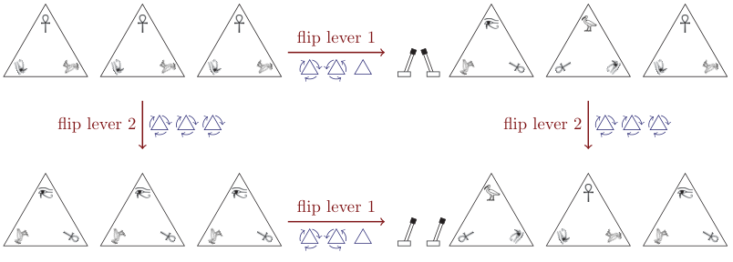

## 题目描述

时间限制：1 秒；内存限制：2048 MB。

著名的埃及学教授 Z Mummer 正在卢克索探索一座新发现的陵墓，她在那里发现了一个神秘的建筑。墙上有一排 $k$ 个金字塔形状的石板。每块石头上有三个象形文字：安卡（顶部）、荷鲁斯之眼（左下）和朱鹭（右下）。

墙旁有 $n$ 个杠杆。教授小心翼翼地进行实验，提防潜在的陷阱，她意识到每个杠杆都会顺时针或逆时针旋转某些金字塔，使得另一个象形文字朝上。拨回杠杆会将相同的金字塔向相反方向旋转回其原始位置。杠杆之间完全独立运作，因此无论其他杠杆处于什么状态，拨动或拨回一个杠杆的效果都是相同的。参见图 Z.1 以获取说明。



图 Z.1：包含 $k=3$ 个金字塔和 $n=2$ 个杠杆的墙壁示意图。第一个杠杆将第一个金字塔顺时针旋转，将第二个金字塔逆时针旋转，并保持第三个金字塔不变。第二个杠杆将所有三个金字塔顺时针旋转。这对应于样例输入 1。

出于好奇，Mummer 教授记录了每个杠杆的单独效果。探险结束后回到大学，她给学生布置了一项艰巨的任务：找出通过拨动杠杆的某些子集可以实现的所有 $2^n$ 种可能的金字塔配置（其中一些可能相同），以便进一步研究。

经过许多个夜晚的仔细计算，学生终于完成了任务并开始整理他的论文。但随后灾难降临：他不小心打翻了墨水，彻底毁掉了教授的原始笔记，而这些笔记包含了每个杠杆单独效果的唯一记录。

逃避 Mummer 教授愤怒的唯一机会是从可能的金字塔配置列表中重建原始笔记。这无法完全唯一地完成（例如，无法区分同一组杠杆的不同顺序）。但只要杠杆仍然能产生计算出的金字塔配置列表，这个错误就不太可能被发现（至少在学生毕业之前是这样）。

## 输入格式

输入的第一行包含三个整数 $n$、$k$ 和 $t$，其中 $n$ ($1 \le n \le 40$) 和 $k$ ($1 \le k \le 5$) 分别是杠杆和金字塔的数量，$t$ ($1 \le t \le 3^k$) 是不同金字塔配置的数量。接下来是 $t$ 行，描述了不同的可能金字塔配置。每一行包含一个长度为 $k$ 的字符串，描述配置，以及一个整数 $f$ ($1 \le f \le 2^n$)，表示导致此配置的不同杠杆设置数量。配置使用字母 'A'、'E' 和 'I' 描述。第 $j$ 个字符表示第 $j$ 个金字塔上朝上的象形文字：'A' 代表安卡，'E' 代表荷鲁斯之眼，'I' 代表朱鹭。

给出的 $t$ 种配置是两两不同的，$f$ 值在所有 $t$ 行上的总和等于 $2^n$，且输入保证至少存在一组杠杆能产生给定的金字塔配置多重集。

## 输出格式

输出 $n$ 行，描述一组可能产生给定金字塔配置多重集的杠杆。每一行使用一个长度为 $k$ 的字符串描述一个杠杆，字符串由符号 '+'、'-' 或 '0' 组成。在每个字符串中，第 $j$ 个符号描述该杠杆对第 $j$ 个金字塔的作用：'+' 表示杠杆顺时针旋转金字塔，'-' 表示逆时针旋转，'0' 表示杠杆不移动该金字塔。

如果有多个可能的解，输出其中任意一个即可。

## 样例

### 样例输入 1

```text
2 3 4
EEE 1
EIA 1
IAE 1
AAA 1
```

### 样例输出 1

```text
+-0
+++
```

### 样例输入 2

```text
3 2 2
IA 4
AA 4
```

### 样例输出 2

```text
-0
00
00
```
