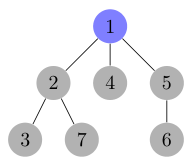
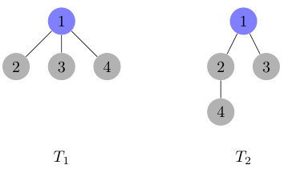

## 题目描述

时间限制：2.0 秒；内存限制：1024 MB。

Little Cyan Fish（又名 Qingyu Xiao）非常喜欢 DFS 序的概念。今天，他有一个根节点为 1、包含 $n$ 个顶点的有根树 $T$。对于 $2 \le i \le n$，顶点 $i$ 的父节点是 $f_i$（满足 $1 \le f_i < i$）。

DFS 序 $D = (D_1, D_2, \dots, D_n)$ 表示在树的深度优先搜索过程中访问节点的序列。出现在该序列第 $j$ 个位置的顶点（其中 $1 \le j \le n$）表示它是在访问了 $j-1$ 个其他顶点后被访问的。在深度优先搜索过程中，如果一个顶点有多个子节点，它们将按照索引的升序进行访问。因此，在本题中，每棵有根树都有唯一的 DFS 序。

下图展示了一棵有 7 个顶点的树。该树的 DFS 序为 $[1, 2, 3, 7, 4, 5, 6]$。



一棵有 7 个顶点的树。该树的 DFS 序为 $[1, 2, 3, 7, 4, 5, 6]$。

以下伪代码描述了给定有根树 $T$ 时生成 DFS 序的方法。$T$ 由数组 $f = \{f_2, \dots, f_n\}$ 唯一表示。函数 `generate()` 返回从根节点 1 开始的 DFS 序：

```text
1: procedure dfs(vertex x)
2: Append x to the end of dfs_order
3: for each child y of x do  // 子节点按索引升序遍历
4: dfs(y)
5: end for
6: end procedure
7: procedure generate()
8: Let dfs_order be a global variable
9: dfs_order ← empty list
10: dfs(1)
11: return dfs_order
12: end procedure
```

令 $D$ 为 `generate()` 返回的数组。数组 $f$ 共有 $(n-1)!$ 种可能的配置，每种配置代表一棵不同的树 $T$。Little Cyan Fish 想知道：对于所有这些 $(n-1)!$ 种 $f$ 的配置，总共可以生成多少种不同的 DFS 序 $D$？我们认为两个 DFS 序 $D$ 和 $D'$ 不同，当且仅当存在一个索引 $1 \le i \le n$ 使得 $D_i \neq D'_i$。由于该数字可能非常大，你的任务是计算这个数字对给定的质数 $P$ 取模的结果。

## 输入格式

第一行包含两个整数 $n$ 和 $P$（$1 \le n \le 800$，$10^8 \le P \le 1.01 \times 10^9$）。 保证 $P$ 是一个质数。

## 输出格式

输出一行，包含一个整数，表示答案。

## 样例

### 样例输入 1

```text
4 114514199
```

### 样例输出 1

```text
2
```

### 样例输入 2

```text
10 998244353
```

### 样例输出 2

```text
11033
```

### 样例输入 3

```text
100 1000000007
```

### 样例输出 3

```text
270904395
```

## 说明

在第一个样例中，有两种不同的 DFS 序：$D_1 = [1, 2, 3, 4]$ 和 $D_2 = [1, 2, 4, 3]$，它们分别可以通过 $T_1: f_2 = 1, f_3 = 1, f_4 = 1$ 和 $T_2: f_2 = 1, f_3 = 1, f_4 = 2$ 得到。



$T_1$ 和 $T_2$
