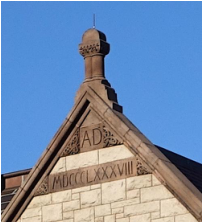

## 题目描述

时间限制：2.0 秒；内存限制：1024 MB。

Little Cyan Fish，也被称为 Qingyu Xiao，热爱各种数字。今天，他正在学习罗马数字。罗马数字是一种起源于古罗马的数字系统，在整个中世纪晚期，它一直是欧洲通用的数字书写方式。在这个数字系统中，数字由拉丁字母的组合书写而成，每个字母都有固定的整数值。在本题中，我们仅考虑 1 到 8 的数字，它们的形式如下：

| 1 | 2 | 3 | 4 | 5 | 6 | 7 | 8 |
| --- | --- | --- | --- | --- | --- | --- | --- |
| I | II | III | IV | V | VI | VII | VIII |

对于一个仅由字母 I 和 V 组成的给定字符串，Little Cyan Fish 想要将其转换为一个整数。为此，他首先会将字符串分解为若干个独立的子串，使得每个子串都代表 1 到 8 之间的一个数字。然后，他将这些数字按顺序写下，从而得到一个整数。例如，对于字符串 VIIIV，Little Cyan Fish 可以将其分解为 VII 和 IV。查阅上表可知，这两个子串分别代表数字 7 和数字 4。他由此得到了整数 74。



现在，Little Cyan Fish 想知道，对于给定的字符串 $S$，通过执行上述过程，他能得到的最小整数是多少。请帮他找到这个值！

## 输入格式

输入文件包含多组测试数据。输入的第一行包含一个整数 $T$ ($1 \le T \le 10^5$)，表示测试数据的组数。

对于每组测试数据，输入包含一行，为一个字符串 $S$ ($1 \le |S| \le 10^5$，$S$ 仅包含字母 I 和 V)。

保证所有测试数据的 $|S|$ 之和不超过 $10^6$。

## 输出格式

对于每组测试数据，输出一行，包含一个整数，表示答案。

## 样例

### 输入格式 1

```text
3
II
IVI
VIIIIIV
```

### 输出格式 1

```text
2
16
634
```

### 说明

在第一组测试数据中，罗马数字 II 可以分解为 \[I, I\] 或 \[II\]，分别对应整数 11 和 2。因此，答案为 2。

在第二组测试数据中，罗马数字 IVI 可以分解为 \[I, V, I\]、\[IV, I\] 和 \[I, VI\]，分别对应整数 151、41 和 16。因此，答案为 16。
