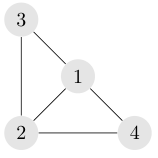
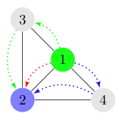
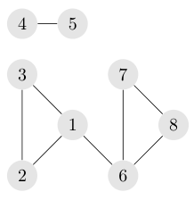

## 题目描述

时间限制：3.0 秒；内存限制：1024 MB。

我们称一个无向图 $G(V, E)$ 为简单图，当且仅当它没有重边或自环。对于一个具有 $|V| \ge 3$ 的简单图 $G(V, E)$，设 $s$ 和 $t$ 为任意两个不同的顶点（分别称为源点和汇点）。流是一个满足以下条件的映射 $f : E \to \mathbb{R}_{\ge 0}$：

-   （容量限制）：边的流量不能超过 1，换句话说，对于所有 $(u, v) \in E$，满足 $0 \le f_{uv} \le 1$。
-   （流量守恒）：流入一个节点的流量之和必须等于流出该节点的流量之和，源点和汇点除外。换句话说， 
    
    $$
    \forall v \in V \setminus \{s, t\} : \sum_{u:(u,v) \in E} f_{uv} = \sum_{u:(v,u) \in E} f_{vu}
    $$
    

请注意，在本题中，所有边的容量均等于 1。换句话说，给定图中的边都是无权的。

流的值是从源点流向汇点的流量大小。形式上，对于流 $f : E \to \mathbb{R}_{\ge 0}$，其值定义为：

$$
|f| = \sum_{v:(s,v) \in E} f_{sv} = \sum_{u:(u,t) \in E} f_{ut}
$$

最大 $s, t$\-流，记作 $\text{maxflow}(s, t)$，是源点为 $s$、汇点为 $t$ 的所有可能流 $f$ 中的最大值。特别地，我们定义对于所有 $u \in V$，$\text{maxflow}(u, u) = 0$。

现在，Little Cyan Fish 正在完成算法课的作业。作业给出了一个具有 $n$ 个顶点（编号从 1 到 $n$）的简单无向图 $G(V, E)$。他的任务是计算矩阵 $A = F(G)$，其中对于每个 $u, v \in V$，有 $A_{u,v} = \text{maxflow}(u, v)$。Little Cyan Fish 觉得这很简单，他更感兴趣的是逆问题：给定矩阵 $A_{u,v}$，如何构造一个无向简单图 $G$ 使得 $F(G) = A$？

当然，这个问题非常困难。所以 Little Cyan Fish 会给你一些更简单的矩阵——仅由整数 $\{0, 1, 2, 3\}$ 组成的矩阵。在这种情况下，你能解决 Little Cyan Fish 提出的挑战吗？

## 输入格式

输入文件包含多组测试数据。输入的第一行包含一个整数 $T$ ($1 \le T \le 10^3$)，表示测试数据的组数。

对于每组测试数据，第一行包含一个整数 $n$ ($1 \le n \le 300$)。 接下来的 $n$ 行描述了矩阵 $A$。第 $i$ 行 ($1 \le i \le n$) 包含 $n$ 个整数 $A_{i,1}, A_{i,2}, \dots, A_{i,n}$。保证对于所有 $1 \le i, j \le n$，都有 $0 \le A_{i,j} \le 3$。

保证所有测试数据的 $n^2$ 之和不超过 $9 \times 10^6$。

## 输出格式

对于每组测试数据，如果没有满足 $F(G) = A$ 的图 $G$，输出一行 “No”。 否则，输出的第一行包含 “Yes”。下一行包含一个整数 $m$，表示你使用的边数。接下来的 $m$ 行每行包含两个整数 $x$ 和 $y$，表示一条边。你需要确保你的解是一个没有重边或自环的简单图。

如果有多种解，你可以输出其中任意一个。

## 样例

### 样例输入 1

```text
4
4
0 3 2 2
3 0 2 2
2 2 0 2
2 2 2 0
8
0 2 2 0 0 1 1 1
2 0 2 0 0 1 1 1
2 2 0 0 0 1 1 1
0 0 0 0 1 0 0 0
0 0 0 1 0 0 0 0
1 1 1 0 0 0 2 2
1 1 1 0 0 2 0 2
1 1 1 0 0 2 2 0
3
0 1 2
1 2 3
2 3 1
12
0 2 2 2 2 2 2 2 2 1 1 1
2 0 2 2 2 2 2 2 2 1 1 1
2 2 0 2 2 2 2 2 2 1 1 1
2 2 2 0 2 2 2 2 2 1 1 1
2 2 2 2 0 2 2 2 2 1 1 1
2 2 2 2 2 0 2 2 2 1 1 1
2 2 2 2 2 2 0 2 2 1 1 1
2 2 2 2 2 2 2 0 2 1 1 1
2 2 2 2 2 2 2 2 0 1 1 1
1 1 1 1 1 1 1 1 1 0 1 1
1 1 1 1 1 1 1 1 1 1 0 1
1 1 1 1 1 1 1 1 1 1 1 0
```

### 样例输出 1

```text
Yes
5
1 2
3 1
3 2
4 1
4 2
Yes
8
1 2
2 3
3 1
6 7
7 8
8 6
1 6
4 5
No
Yes
12
1 2
2 3
3 4
4 5
5 6
6 7
7 8
8 9
9 1
1 10
10 11
11 12
```

## 说明

在第一组测试数据中，一种可能的图如下图所示。



以 $A_{1,2} = 3$ 为例，下图显示了 $|f_{\max}| = 3$。因此 $\text{maxflow}(1, 2)$ 的约束得到满足。



在第二组测试数据中，一种可能的图如下图所示。



在第三组测试数据中，显然 $A_{u,u} = 0$ 的条件未被满足。因此，不存在对应于该矩阵的图。
