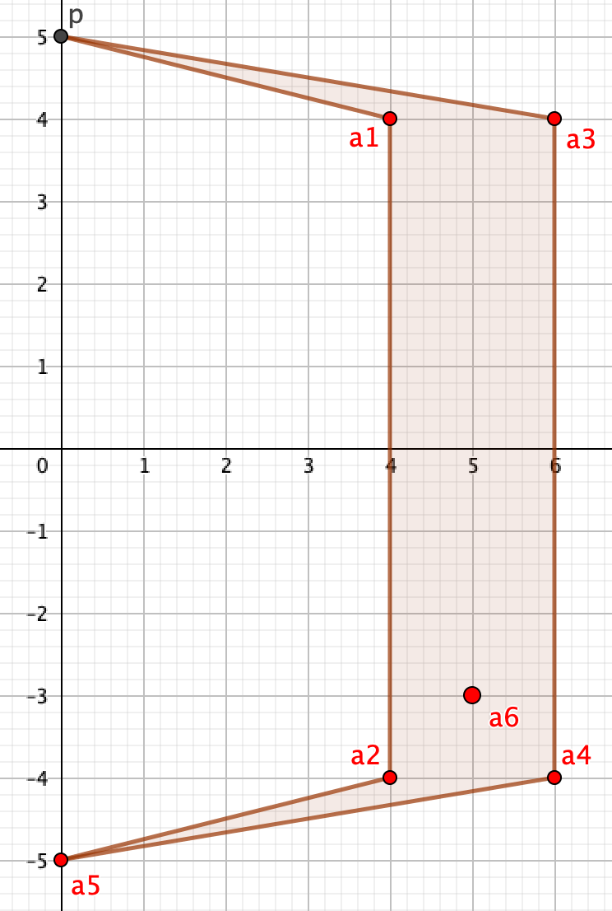

## 题目描述

时间限制：4.0 秒；内存限制：1024 MB。

Noah 玩过一款 RPG 游戏，在游戏中他骑着一只巨大的驼鹿去寻找一个秘密造船厂。游戏里的寻路系统非常糟糕。Noah 一直在幻想如果游戏有完善的地图导航会是什么样。

游戏中的地图可以表示为一个简单多边形 $M$。Noah 不能走出 $M$ 的范围。造船厂位于 $M$ 内部（或边界上）的一个特定点 $p$。一个完善的地图导航系统应该始终显示 $p$ 与 Noah 当前位置之间的最短路径。给定 $M$、$p$ 以及 Noah 的若干位置 $a_1, \dots, a_Q$，请编写一个程序，计算对于所有 $1 \le i \le Q$，点 $a_i$ 与 $p$ 之间的最短路径长度。

## 输入格式

输入文件包含多个测试用例。第一行包含一个整数 $T$ ($1 \le T \le 5000$)，表示测试用例的数量。接下来是各测试用例的描述。

每个测试用例的第一行包含一个整数 $n$ ($3 \le n \le 5000$)，表示简单多边形 $M$ 的顶点数。

接下来的 $n$ 行，每行包含 $M$ 的一个顶点。顶点按逆时针顺序给出。

下一行包含目标点 $p$。

下一行包含一个整数 $Q$ ($1 \le Q \le 5000$)，表示查询的数量。

接下来的 $Q$ 行，每行包含一个查询点 $a_i$。

点由一对坐标 $x$ 和 $y$ 表示，中间用空格隔开。所有坐标均为整数，绝对值不超过 $2000$。输入中的所有点均位于 $M$ 内部或边界上。保证 $M$ 是简单多边形，即其顶点互不相同，且除相邻边在公共顶点处相交外，多边形的任意两条边均不相交或接触。所有测试用例中 $n$ 的总和不超过 $5000$。所有测试用例中 $Q$ 的总和不超过 $5000$。

## 输出格式

对于每个测试用例，输出 $Q$ 行。第 $i$ 行应包含 $a_i$ 与 $p$ 之间的最短路径长度。如果你的答案的绝对误差或相对误差不超过 $10^{-6}$，则视为正确。

## 样例

### 输入 1

```text
1
6
0 5
4 4
4 -4
0 -5
6 -4
6 4
0 5
6
4 4
4 -4
6 4
6 -4
0 -5
5 -3
```

### 输出 1

```text
4.123105625618
12.123105625618
6.082762530298
12.369316876853
16.246211251235
11.194173437483
```

## 说明

下图为样例的示意图。



样例示意图
