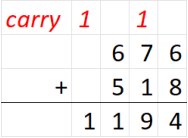

## 题目描述

时间限制：1.0 秒；内存限制：1024 MB。

在学习了基础数学后，Little Cyan Fish 掌握了“进位”（carry）的概念，即从一个数位向更高位传递的数值。



现在，Little Cyan Fish 给出了两个 $m$ 进制下的数字 $A$ 和 $B$。对于每个数字，你可以任意排列它的数位。排列后，你将得到两个新的数字 $A'$ 和 $B'$，且允许出现前导零。在 $m$ 进制下计算 $A' + B'$ 时，最多能产生多少次进位？

## 输入格式

输入包含多组测试数据。第一行包含一个整数 $T$ ($1 \le T \le 2 \times 10^5$)，表示测试数据组数。

对于每组测试数据，第一行包含一个整数 $m$ ($2 \le m \le 5 \times 10^5$)。

第二行包含 $m$ 个整数 $a_0, a_1, \dots, a_{m-1}$ ($0 \le a_i \le 10^9$)，$a_i$ 表示数字 $i$ 在 $A$ 中出现的次数。

第三行包含 $m$ 个整数 $b_0, b_1, \dots, b_{m-1}$ ($0 \le b_i \le 10^9$)，$b_i$ 表示数字 $i$ 在 $B$ 中出现的次数。

保证所有测试数据的 $m$ 之和不超过 $5 \times 10^5$。

## 输出格式

对于每组测试数据，输出一个整数，表示最大进位次数。

## 样例

### 输入 1

```text
5
2
1 2
3 4
3
1 0 1
0 1 0
4
1 0 0 1
1 1 1 1
5
123456 114514 1919810 233333 234567
20050815 998244353 0 0 0
10
5 3 5 3 2 4 2 4 1 5
9 9 8 2 4 4 3 5 3 0
```

### 输出 1

```text
5
1
2
467900
29
```
